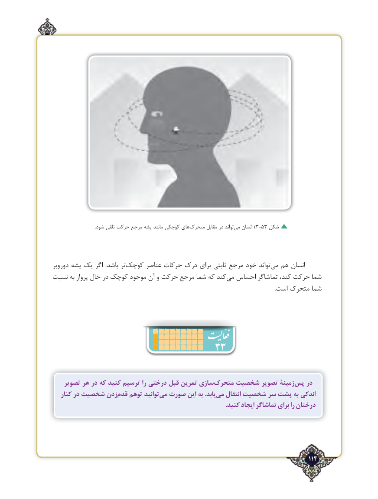

# PDF page 114

.شود تلقی حرکت مرجع پشه مانند کوچکی هایمتحرک‌       مقابل در تواند‌)می انسان 3-53 شکل

دوروبر پشه یک اگر  .باشد تر‌کوچک عناصر حرکات درک برای ثابتی مرجع خود تواند ‌می هم انسان
نسبت به پرواز حال در کوچک موجود آن و حرکت مرجع شما که کندمی‌  احساس تماشاگر کند، حرکت شما
                                                                                                                                                                 .است متحرک شما

                              33

    تصویر هر در که کنید ترسیم را درختی قبل تمرین سازیمتحرک‌    شخصیت تصویر زمینۀپس‌   در
   کنار در شخصیت زدنقدم‌   توهم توانیدمی‌  صورت این به .یابدمی‌   انتقال شخصیت سر پشت به اندکی
                                                                                                              .کنید ایجاد تماشاگر برای را درختان

                                                                                    114٢

