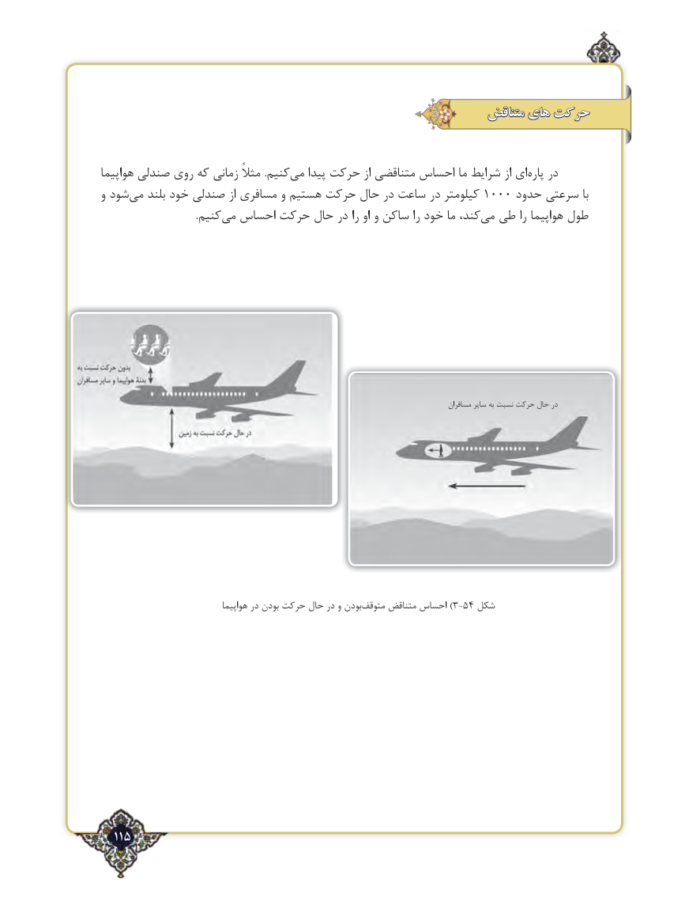

# PDF page 115

متناقض های حرکت

هواپیما صندلی روی که زمانی مثالً .کنیممی‌   پیدا حرکت از متناقضی احساس ما شرایط از ای ‌پاره در
و شود‌می بلند خود صندلی از مسافری و هستیم حرکت حال در ساعت در کیلومتر 1000 حدود سرعتی با
      .‌کنیممی احساس حرکت حال در را او و ساکن را خود ما کند،‌می طی را هواپیما طول

                                                                                                        مسافران سایر به نسبت حرکت حال در

                                  هواپیما در بودن‌حرکت حال در و بودنمتوقف‌)متناقض احساس 3-54 شکل

  115٢

