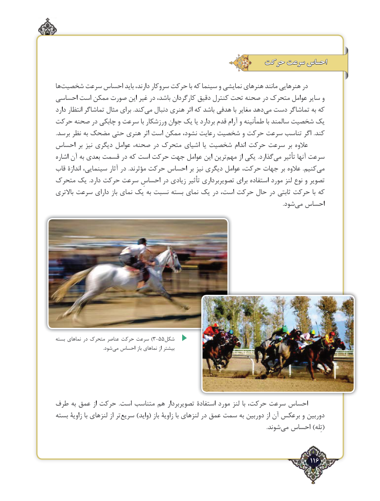

# PDF page 116

حرکت سرعت احساس

ها‌شخصیت سرعت احساس باید دارند، سروکار حرکت با که سینما و نمایشی هنرهای مانند هنرهایی در
احساسی است ممکن صورت این غیر در باشد، کارگردان دقیق کنترل تحت صحنه در متحرک عوامل سایر و
دارد انتظار تماشاگر مثال برای .کند‌می دنبال هنری اثر که باشد هدفی با مغایر دهدمی‌  دست تماشاگر به که
حرکت صحنه در چابکی و سرعت با ورزشکار جوان یک یا بردارد قدم آرام و طمأنینه با سالمند شخصیت یک
.برسد نظر به مضحک حتی هنری اثر است ممکن نشود، رعایت شخصیت و حرکت سرعت تناسب اگر .کند
احساس بر نیز دیگری عوامل صحنه، در متحرک اشیای یا شخصیت اندام حرکت سرعت بر عالوه
اشاره آن به بعدی قسمت در که است حرکت جهت عوامل این ترین ‌مهم از یکی .گذاردمی‌   تأثیر آنها سرعت
قاب اندازۀ سینمایی، آثار در  .مؤثرند حرکت احساس بر نیز دیگری عوامل حرکت، جهات بر عالوه  .کنیممی‌
متحرک یک  .دارد حرکت سرعت احساسِ در زیادی تأثیر تصویربرداری برای استفاده مورد لنز نوع و تصویر
باالتری سرعت دارای باز نمای یک به‌ نسبت بسته نمای یک در است، حرکت حال در ثابتی حرکت با که
                                .‌شودمی احساس

بسته نماهای در متحرک عناصر حرکت سرعت )3-55شکل
         .‌شودمی احساس باز نماهای از بیشتر

طرف به عمق از حرکت  .است متناسب هم تصویربردار استفادۀ مورد لنز با حرکت، سرعت احساس
بسته زاویۀ با لنزهای از تر ‌سریع )واید( باز زاویۀ با لنزهای در عمق سمت به دوربین از آن برعکس و دوربین
           .‌(شوند می احساس )تِله

                                                                                   116٢

