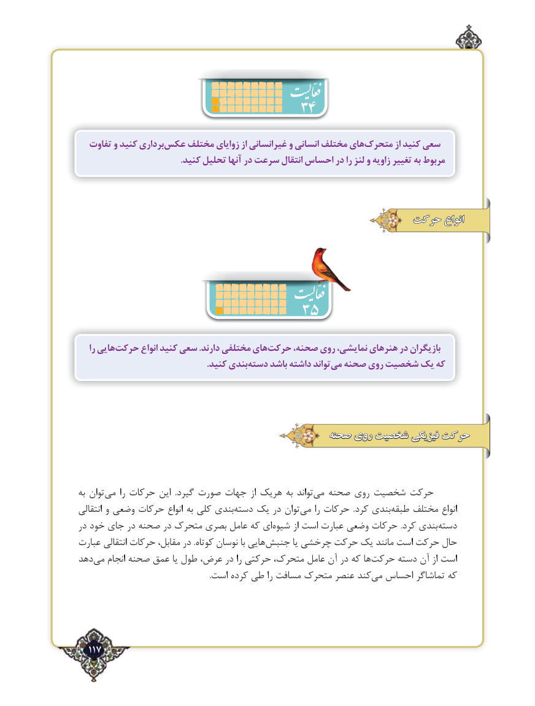

# PDF page 117

تفاوت و کنید برداریعکس‌    مختلف زوایای از غیرانسانی و انسانی مختلف هایمتحرک‌         از کنید سعی
                                              .کنید تحلیل آنها در سرعت انتقال احساس در را لنز و زاویه تغییر به مربوط

                                               حرکت انواع

                           35
    را هاییحرکت‌       انواع کنید سعی .دارند مختلفی هایحرکت‌     صحنه، روی نمایشی، هنرهای در بازیگران
      .‌کنید بندیدسته باشد داشته تواندمی‌  صحنه روی شخصیت یک که

                                             صحنه روی شخصیت فیزیکی حرکت

به توان‌می را حرکات این  .گیرد صورت جهات از هریک به تواند‌می صحنه روی شخصیت حرکت
انتقالی و وضعی حرکات انواع به کلی بندی ‌دسته یک در توان‌می را حرکات  .کرد بندی ‌طبقه مختلف انواع‌
در خود جای در صحنه در متحرک بصری عامل که ای‌شیوه از است عبارت وضعی حرکات .کرد بندی ‌دسته
عبارت انتقالی حرکات مقابل، در .کوتاه نوسان با هایی‌جنبش یا چرخشی حرکت یک مانند است حرکت حال
دهد ‌می انجام صحنه عمق یا طول عرض، در را حرکتی متحرک، عامل آن در که ها ‌حرکت دسته آن از است
                                                                   .است کرده طی را مسافت متحرک عنصر کند ‌می احساس تماشاگر که

  117٢

