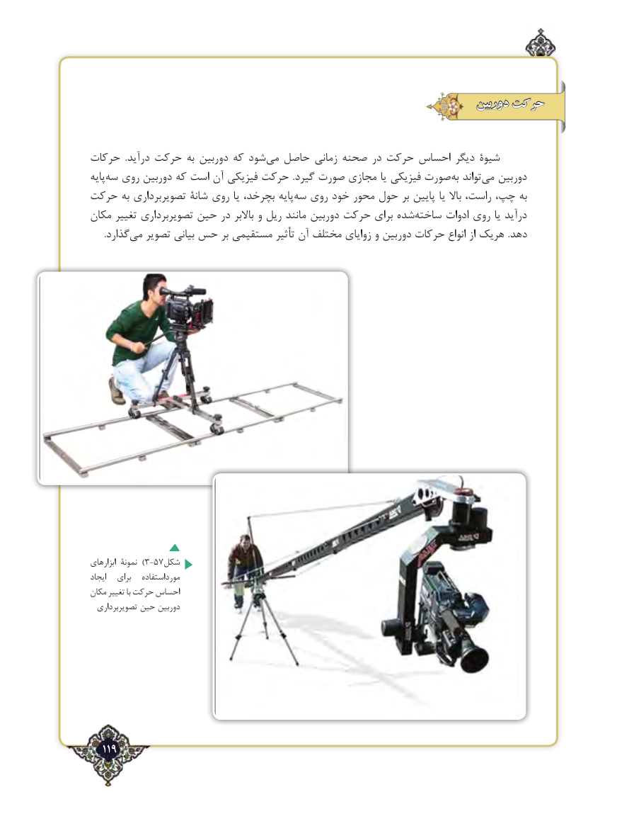

# PDF page 119

دوربین حرکت

حرکات  .درآید حرکت به دوربین که شود‌می حاصل زمانی صحنه در حرکت احساس دیگر شیوۀ
پایه‌سه روی دوربین که است آن فیزیکی حرکت  .گیرد صورت مجازی یا فیزیکی صورت ‌به تواند ‌می دوربین
حرکت به تصویربرداری شانۀ روی یا بچرخد، پایه ‌سه روی خود محور حول بر پایین یا باال راست، چپ، به
مکان تغییر تصویربرداری حین در باالبر و ریل مانند دوربین حرکت برای شده ‌ساخته ادوات روی یا درآید
 .‌گذاردمی تصویر بیانی حس بر مستقیمی تأثیر آن مختلف زوایای و دوربین حرکات انواع از هریک .دهد

ابزارهای نمونۀ  )3-57شکل
ایجاد   برای   مورداستفاده
مکان تغییر با حرکت احساس
  تصویربرداری حین دوربین

  119٢

