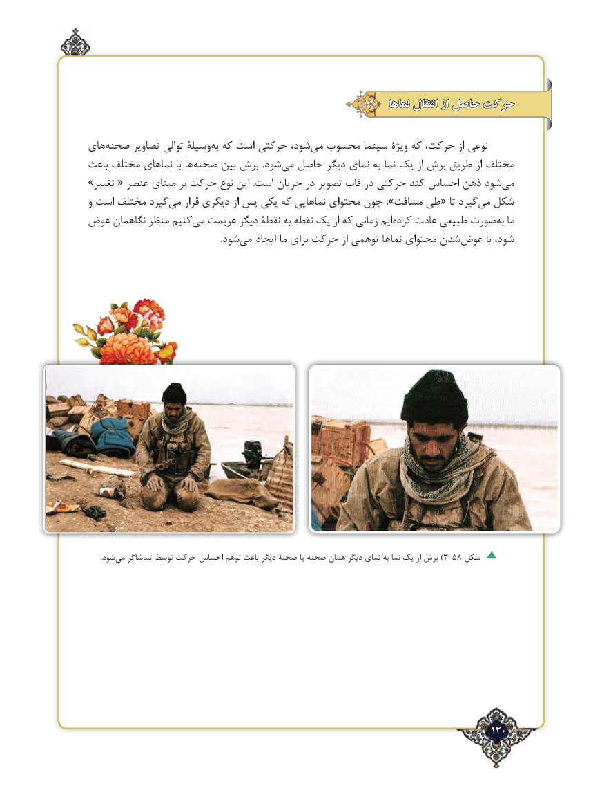

# PDF page 120

نماها انتقال از حاصل حرکت

های‌صحنه تصاویر توالی وسیلۀ‌به که است حرکتی شود، ‌می محسوب سینما ویژۀ که حرکت، از نوعی
باعث مختلف نماهای با ها‌صحنه بین برش  .شود ‌می حاصل دیگر نمای به نما یک از برش طریق از مختلف
»تغییر « عنصر مبنای بر حرکت نوع این .است جریان در تصویر قاب در حرکتی کند احساس ذهن شود‌می
و است مختلف گیردمی‌   قرار دیگری از پس یکی که نماهایی محتوای چون ،»مسافت طی« تا گیردمی‌  شکل
عوض نگاهمان منظر کنیممی‌  عزیمت دیگر نقطۀ به نقطه یک از که زمانی ایم‌کرده عادت طبیعی صورت‌به ما
            .‌شود می ایجاد ما برای حرکت از توهمی نماها محتوای شدن‌عوض با شود،

       .شود‌)می تماشاگر توسط حرکت احساس توهم باعث دیگر صحنۀ یا صحنه همان دیگر نمای به نما یک از برش 3-58 شکل

                                                                                   120٢

