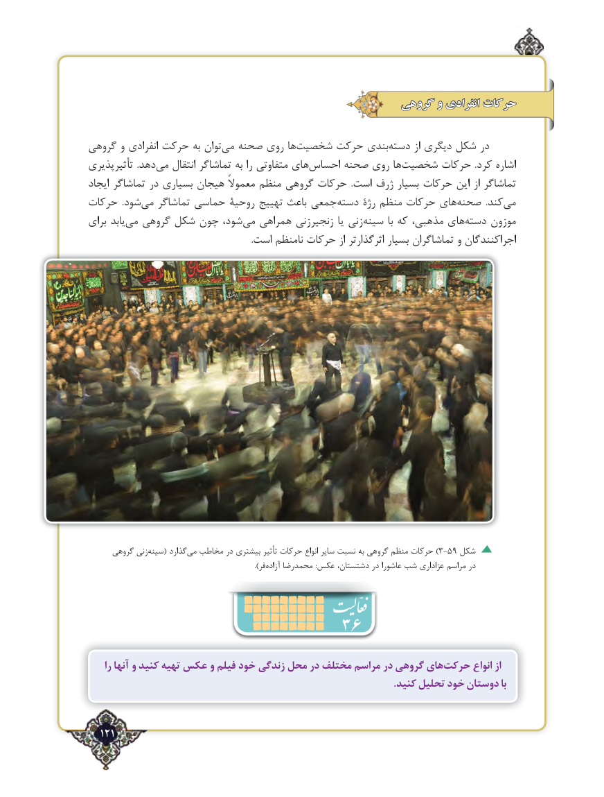

# PDF page 121

گروهی و انفرادی حرکات

گروهی و انفرادی حرکت به توان ‌می صحنه روی ها‌شخصیت حرکت بندی ‌دسته از دیگری شکل در
تأثیرپذیری  .دهدمی‌   انتقال تماشاگر به را متفاوتی های‌احساس صحنه روی هاشخصیت‌      حرکات  .کرد اشاره
ایجاد تماشاگر در بسیاری هیجان معموالً منظم گروهی حرکات  .است ژرف بسیار حرکات این از تماشاگر
حرکات  .شود ‌می تماشاگر حماسی روحیۀ تهییج باعث جمعی ‌دسته رژۀ منظم حرکات های ‌صحنه  .کندمی‌
برای یابد‌می گروهی شکل چون شود،‌می همراهی زنجیرزنی یا زنیسینه‌        با که مذهبی، های ‌دسته موزون
                                                                          .است نامنظم حرکات از اثرگذارتر بسیار تماشاگران و اجراکنندگان

     گروهی زنیسینه‌     ( گذارد‌)می مخاطب در بیشتری تأثیر حرکات انواع سایر نسبت به گروهی منظم حرکات 3-59 شکل
                                    ).‌فر آزاده محمدرضا :عکس دشتستان، در عاشورا شب عزاداری مراسم در
                           36
     را آنها و کنید تهیه عکس و فیلم خود زندگی محل در مختلف مراسم در گروهی هایحرکت‌       انواع از
                                                                                                                          .کنید تحلیل خود دوستان با

  121٢

