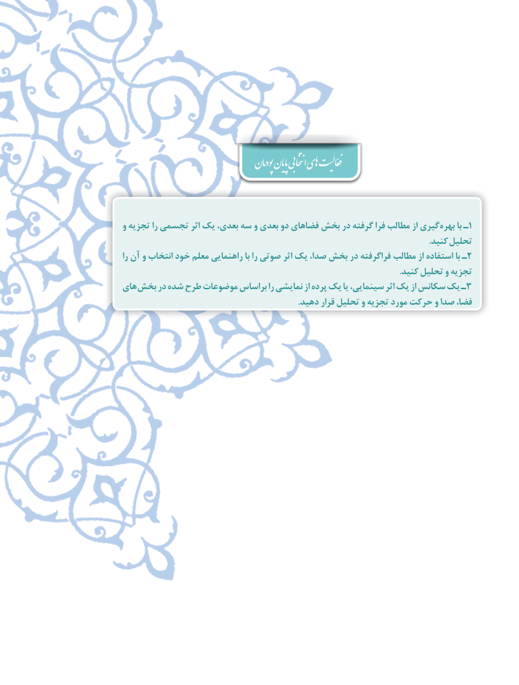

# PDF page 122

پودمان پایان انتخابی اهی  فعّالیت

و تجزیه را تجسمی اثر یک بعدی، سه و بعدی دو فضاهای بخش در گرفته فرا مطالب از گیری بهره١با ـ
                                                                                                                                              .کنید تحلیل
را آن و انتخاب خود معلم راهنمایی با را صوتی اثر یک صدا، بخش در فراگرفته مطالب از استفاده با ـ2
                                                                                                                                 .کنید تحلیل و تجزیه
های بخش در شده طرح موضوعات براساس را نمایشی از پرده یک یا سینمایی، اثر یک از سکانس یک ـ3
                                                                                  .دهید قرار تحلیل و تجزیه مورد حرکت و صدا فضا،

                                                                        122٢

