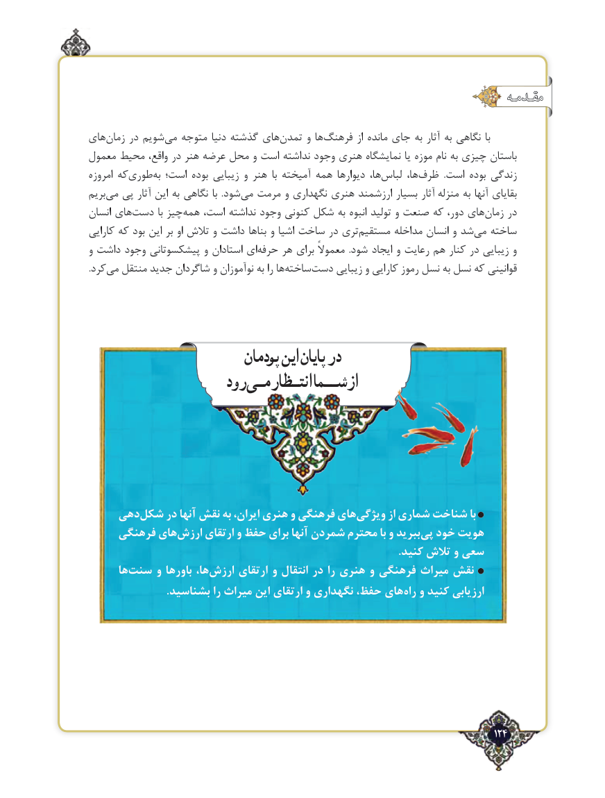

# PDF page 124

مقـدمـه

های‌زمان در شویم‌می متوجه دنیا گذشته های‌تمدن و ها‌فرهنگ از مانده ‌جای به آثار به نگاهی  با
معمول محیط واقع، در هنر عرضه محل و است نداشته وجود هنری نمایشگاه یا موزه نام به چیزی باستان
امروزه که‌طوری‌به است؛ بوده زیبایی و هنر  با آمیخته همه دیوارها ها،‌لباس ها، ‌ظرف  .است بوده زندگی
بریم‌می پی آثار این به نگاهی با  .شود ‌می مرمت و نگهداری هنری ارزشمند بسیار آثار منزله ‌ به آنها بقایای
انسان های‌دست با چیزهمه‌   است، نداشته وجود کنونی شکل به انبوه تولید و صنعت که دور، های‌زمان در
کارایی که بود این بر او تالش و داشت بناها و اشیا ساخت در تری ‌مستقیم مداخله انسان و شد‌می ساخته
و داشت وجود پیشکسوتانی و استادان ای‌حرفه هر برای معموالً  .شود ایجاد و رعایت هم کنار در زیبایی و
.کرد‌می منتقل جدید شاگردان و نوآموزان به را ها‌ساخته‌دست زیبایی و کارایی رموز نسل به نسل که قوانینی

                          پودمان اینپایان در
                    رود انتـظارمـیشــمااز

    دهی‌شکل در آنها نقش به ایران، هنری و فرهنگی هایویژگی‌       از شماری شناخت با
     فرهنگی هایارزش‌     ارتقای و حفظ برای آنها شمردن ‌محترم با و ببریدپی‌  خود هویت
                                                                                                                  .کنید تالش و سعی
      ها‌سنت و باورها ها،‌ارزش ارتقای و انتقال در را هنری و فرهنگی میراث نقش
                             .بشناسید را میراث این ارتقای و نگهداری حفظ، های‌راه و کنید ارزیابی

                                                                                   124٢

