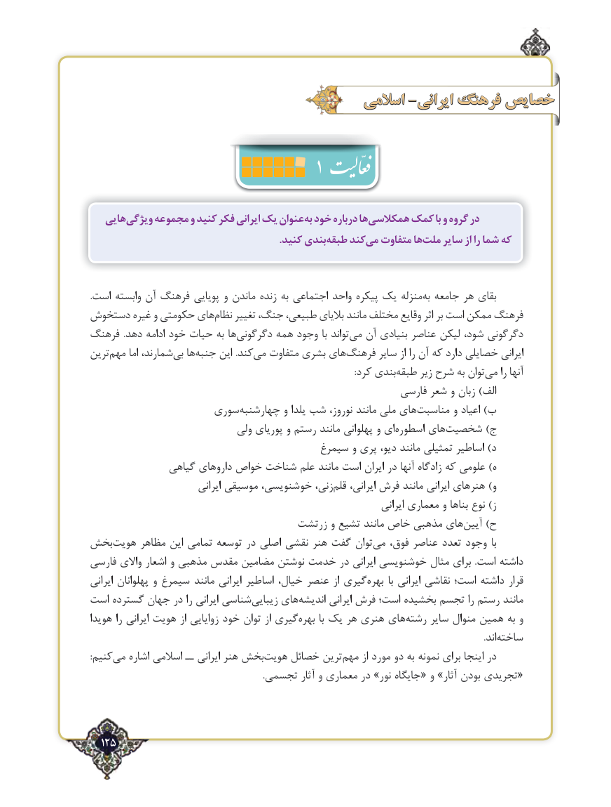

# PDF page 125

اسالمی -ایرانی فرهنگ خصایص
                                              1
   هاییویژگی‌    مجموعه و کنید فکر ایرانی یک عنوانبه‌ خود درباره هاهمکالسی‌     کمک با و گروه در
        .‌کنید بندیطبقه کندمی‌  متفاوت هاملت‌    سایر از را شما که

.است وابسته آن فرهنگ پویایی و ماندن زنده‌    به اجتماعی واحد پیکره یک منزلهبه‌  جامعه هر بقای
دستخوش غیره و حکومتی هاینظام‌    تغییر جنگ، طبیعی، بالیای مانند مختلف وقایع اثر بر است ممکن فرهنگ
فرهنگ  .دهد ادامه خود حیات به هادگرگونی‌      همه وجود با تواندمی‌  آن بنیادی عناصر لیکن شود، دگرگونی
ترینمهم‌     اما شمارند،بی‌  هاجنبه‌     این .کندمی‌   متفاوت بشری هایفرهنگ‌      سایر از را آن که دارد خصایلی ایرانی
            :‌کرد بندیطبقه زیر شرح به توانمی‌    را آنها
                                                           فارسی شعر و زبان )الف
                    سوری ‌چهارشنبه و یلدا شب نوروز، مانند ملی های ‌مناسبت و اعیاد )ب
                             ولی پوریای و رستم مانند پهلوانی و ای ‌اسطوره های‌شخصیت )ج
                                        سیمرغ و پری دیو، مانند تمثیلی اساطیر )د
               گیاهی داروهای خواص شناخت علم مانند است ایران در آنها زادگاه که علومی )ه
                            ایرانی موسیقی خوشنویسی، زنی،قلم‌    ایرانی، ‌فرش مانند ایرانی هنرهای )و
                                                                            ایرانی معماری و بناها نوع )ز
                                   زرتشت و تشیع مانند خاص مذهبی های‌آیین )ح
بخش ‌هویت مظاهر این تمامی توسعه در اصلی نقشی هنر گفت توان ‌می فوق، عناصر تعدد وجود  با
فارسی واالی اشعار و مذهبی مقدس مضامین نوشتن خدمت در ایرانی خوشنویسی مثال برای  .است داشته
ایرانی پهلوانان و سیمرغ مانند ایرانی اساطیر خیال، عنصر از گیریبهره‌       با ایرانی نقاشی است؛ داشته قرار
است گسترده جهان در را ایرانی شناسی‌زیبایی های‌اندیشه ایرانی فرش است؛ بخشیده تجسم را رستم مانند
هویدا را ایرانی هویت از زوایایی خود توان از گیریبهره‌      با یک هر هنری های ‌رشته سایر منوال همین به و
                                                                                                                                                                                 .اند‌ساخته
:کنیممی‌   اشاره اسالمی ــ ایرانی هنر بخش ‌هویت خصائل ترین‌مهم از مورد دو به نمونه برای اینجا در
                                                                              .تجسمی آثار و معماری در »نور جایگاه« و »آثار بودن ‌ تجریدی«

  125٢

