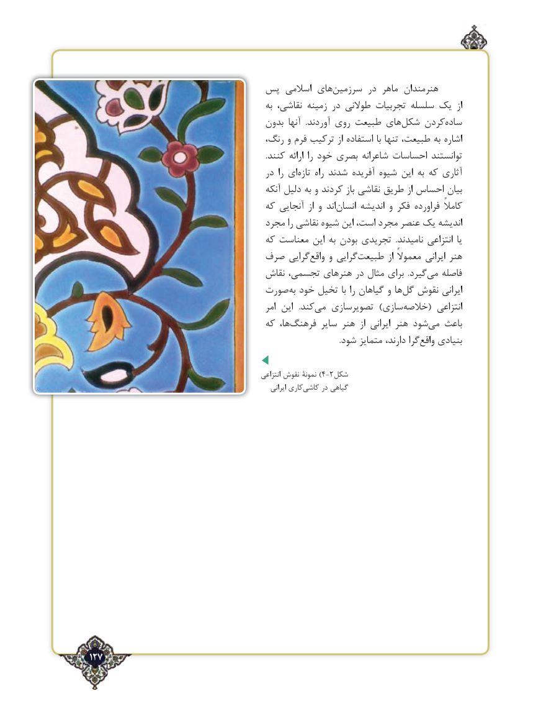

# PDF page 127

پس اسالمی های‌سرزمین در ماهر هنرمندان
                                                  به نقاشی، زمینه در طوالنی تجربیات سلسله یک  از
                                       بدون آنها  .آوردند‌ روی طبیعت های‌شکل کردنساده‌
                                      رنگ، و فرم ترکیب از استفاده با تنها طبیعت، به اشاره
                                                                                         .کنند ارائه را خود بصری شاعرانه احساسات توانستند
                                          در را ای‌تازه راه شدند آفریده شیوه این به که آثاری
                                              آنکه دلیل به و کردند باز نقاشی طریق از احساس بیان
                                     که آنجایی  از و اند ‌انسان اندیشه و فکر فراورده کامالً
                                    مجرد را نقاشی شیوه این است، مجرد عنصر یک اندیشه
                                     که معناست این به بودن تجریدی  .نامیدند انتزاعی یا
                           صرف گراییواقع‌    و گراییطبیعت‌          از معموالً ایرانی هنر
                                    نقاش تجسمی، هنرهای در مثال برای  .گیردمی‌   فاصله
                              صورت‌به خود تخیل با را گیاهان و ها‌گل نقوش ایرانی
                                                    امر این   .کندمی‌   تصویرسازی  )سازی‌خالصه( انتزاعی
                                     که ها، ‌فرهنگ سایر هنر  از ایرانی هنر شود‌می باعث
                                                                                                                               .شود متمایز دارند، گرا‌واقع بنیادی

                                                             انتزاعی نقوش نمونۀ )4-2شکل
                                                                      ایرانی کاری‌کاشی در گیاهی

127٢

