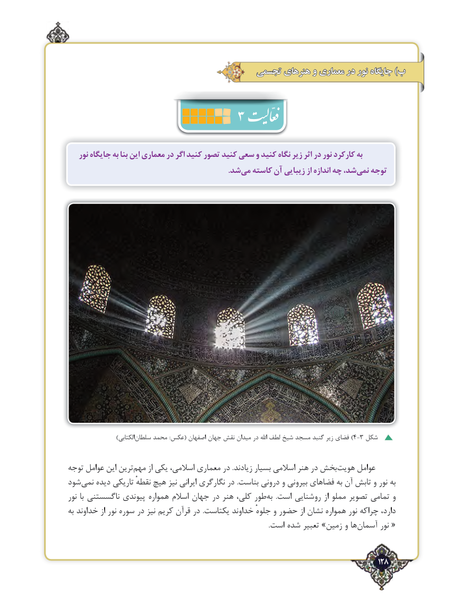

# PDF page 128

تجسمی هنرهای و معماری در نور جایگاه )ب
                         3
   نور جایگاه به بنا این معماری در اگر کنید تصور کنید سعی و کنید نگاه زیر اثر در نور کارکرد به
                      .‌شدمی کاسته آن زیبایی از اندازه چه شد،نمی‌   توجه

                      )الکتابیسلطان‌     محمد :عکس( اصفهان جهان نقش میدان در اهلل ‌)لطف شیخ مسجد گنبد زیر فضای 4-3 شکل

توجه عوامل این ترین‌مهم از یکی اسالمی، معماری در .زیادند بسیار اسالمی هنر در بخش‌هویت عوامل
شود‌نمی دیده تاریكی نقطهٔ هیچ نیز ایرانی نگارگری در .بناست درونی و بیرونی فضاهای به آن تابش و نور به
نور با ناگسستنی پیوندی همواره اسالم جهان در هنر کلی، طور ‌به  .است روشنایی از مملو تصویر تمامی و
به خداوند از نور سوره در نیز کریم قرآن در .یکتاست خداوند جلوهٔ و حضور از نشان همواره نور چراكه دارد،
     .‌«است شده تعبیر »زمین و ها آسمان نور

                                                                                   128٢

