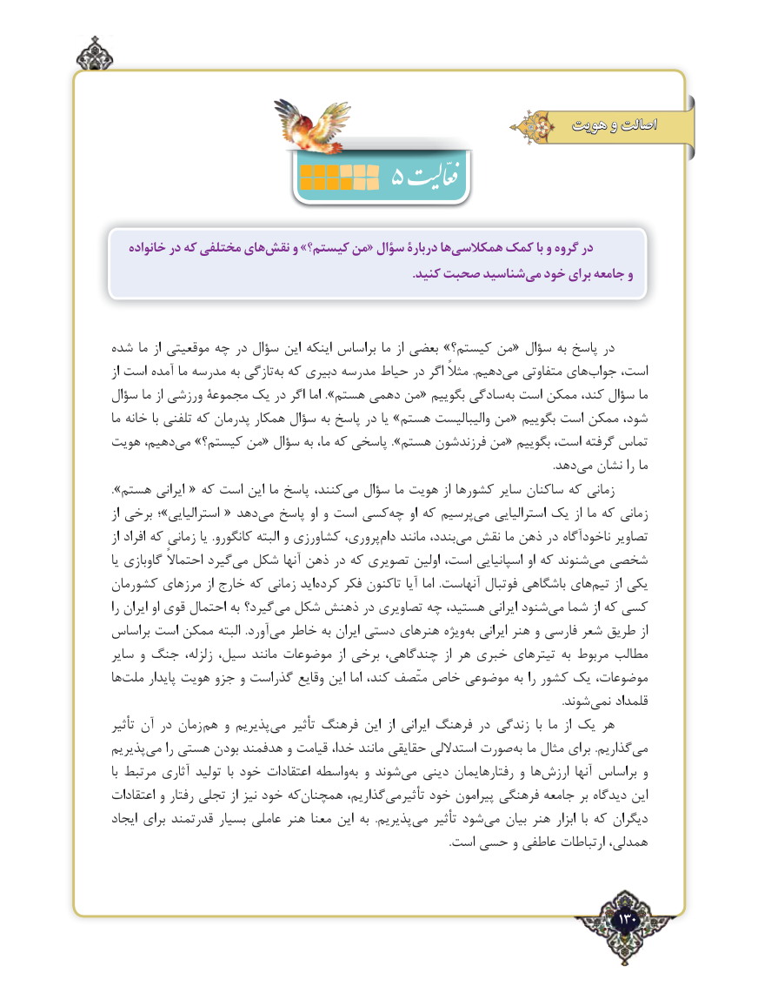

# PDF page 130

هویت و اصالت
                     5
   خانواده در که مختلفی هاینقش‌    و »کیستم؟ من« سؤال دربارۀ هاهمکالسی‌     کمک با و گروه در
     .‌کنید صحبت شناسیدمی خود برای جامعه و

شده ما از موقعیتی چه در سؤال این اینکه براساس ما از بعضی »کیستم؟ من« سؤال به پاسخ در
از است آمده ما مدرسه به تازگی‌به که دبیری مدرسه حیاط در اگر مثالً .دهیم ‌می متفاوتی های‌جواب است،
سؤال ما از ورزشی مجموعۀ یک در اگر اما ».هستم دهمی من« بگوییم سادگی‌به است ممکن کند، سؤال ما
ما خانه با تلفنی که پدرمان همکار سؤال به پاسخ در یا »هستم والیبالیست من« بگوییم است ممکن شود،
هویت دهیم، ‌می »کیستم؟ من« سؤال به ما، که پاسخی ».هستم فرزندشون من« بگوییم است، گرفته تماس
                                                                                                                                                                .دهد ‌می نشان را ما
».هستم ایرانی « که است این ما پاسخ کنند،می‌   سؤال ما هویت از کشورها سایر ساکنان که زمانی
از برخی ؛»استرالیایی « دهد‌می پاسخ او و است کسی‌چه او که پرسیم‌می استرالیایی یک از ما که زمانی
از افراد که زمانی یا  .کانگورو البته و کشاورزی پروری،‌دام مانند بندد،می‌  نقش ما ذهن در ناخودآگاه تصاویر
یا گاوبازی احتماالً گیردمی‌  شکل آنها ذهن در که تصویری اولین است، اسپانیایی او که شنوندمی‌  شخصی
کشورمان مرزهای از خارج که زمانی اید‌کرده فکر تاکنون آیا اما  .آنهاست فوتبال باشگاهی های‌تیم از یکی
را ایران او قوی احتمال به گیرد؟می‌  شکل ذهنش در تصاویری چه هستید، ایرانی شنودمی‌  شما از که کسی
براساس است ممکن البته  .آورد‌می خاطر به ایران دستی هنرهای ویژه‌به ایرانی هنر و فارسی شعر طریق از
سایر و جنگ زلزله، سیل، مانند موضوعات از برخی چندگاهی، از هر خبری تیترهای به مربوط مطالب
ها‌ملت پایدار هویت جزو و گذراست وقایع این اما کند، متّصف خاص موضوعی به را کشور یک موضوعات،
                            .‌شوند نمی قلمداد
تأثیر آن در زمان  ‌هم و پذیریم‌می تأثیر فرهنگ این  از ایرانی فرهنگ در زندگی  با ما  از یک هر
پذیریم‌می را هستی بودن هدفمند و قیامت خدا، مانند حقایقی استداللی صورت ‌به ما مثال برای .گذاریم‌می
با مرتبط آثاری تولید  با خود اعتقادات واسطه ‌به و شوند ‌می دینی رفتارهایمان و ها‌ارزش آنها براساس و
اعتقادات و رفتار تجلی از نیز خود که‌همچنان گذاریم،‌تأثیرمی خود پیرامون فرهنگی جامعه بر دیدگاه این
ایجاد برای قدرتمند بسیار عاملی هنر معنا این به  .پذیریم‌می تأثیر شود ‌می بیان هنر ابزار  با که دیگران
                                                                                                                          .است حسی و عاطفی ارتباطات همدلی،

                                                                                   130٢

