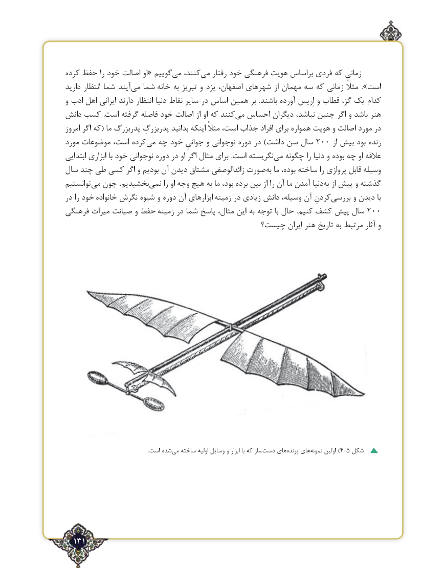

# PDF page 131

‌کرده حفظ را خود اصالت او« گوییممی‌   کنند،می‌   رفتار خود فرهنگی هویت براساس فردی که زمانی
دارید انتظار شما آیند‌می شما خانه به تبریز و یزد اصفهان، شهرهای از مهمان سه که زمانی مثالً ».است
و ادب اهل ایرانی دارند انتظار دنیا نقاط سایر در اساس همین بر  .باشند ‌آورده اِریس و قطاب گز، یک ‌کدام
دانش کسب .است گرفته فاصله خود اصالت از او که کنند‌می احساس دیگران نباشد، چنین اگر و باشد هنر
امروز اگر که( ما پدربزرگ پدربزرگِ بدانید اینکه مثالً است، جذاب افراد برای همواره هویت و اصالت مورد در
مورد موضوعات است، کردهمی‌  چه خود جوانیِ و نوجوانی دوره در )داشت سن سال 200 از بیش بود زنده
ابتدایی ابزاری با خود نوجوانی دوره در او اگر مثال برای .است نگریستهمی‌  چگونه را دنیا و بوده چه او عالقه
سال چند طی کسی اگر و بودیم آن دیدن مشتاق زائدالوصفی صورت‌به ما بوده، ساخته را پروازی قابل وسیله
توانستیم ‌می چون بخشیدیم،‌نمی را او وجه ‌هیچ‌به ما بود، برده بین از را آن ما آمدن دنیابه‌  از پیش و گذشته
در را خود خانواده نگرش شیوه و دوره آن ابزارهای زمینه در زیادی دانش وسیله، آن کردنِبررسی‌      و دیدن با
فرهنگی میراث صیانت و حفظ زمینه در شما پاسخ مثال، این به توجه با حال  .کنیم کشف پیش سال 200
                                        چیست؟ ایران هنر تاریخ به مرتبط آثار و

                                                                  .است شده‌می ساخته اولیه وسایل و ابزار با که ساز ‌دست های‌پرنده های‌)نمونه اولین 4-5 شکل

  131٢

