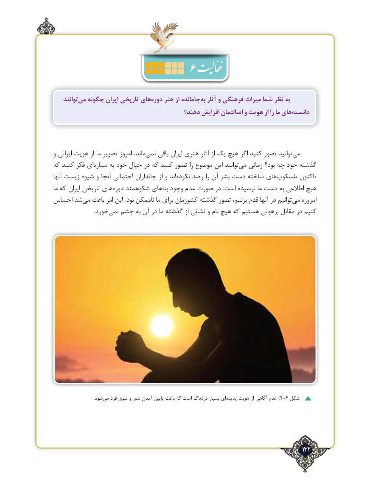

# PDF page 132

توانندمی‌  چگونه ایران تاریخی هایدوره‌    هنر از جاماندهبه‌  آثار و فرهنگی میراث شما نظر به
                                        دهند؟ افزایش اصالتمان و هویت از را ما هایدانسته‌

و ایرانی هویت از ما تصویر امروز ماند،‌نمی باقی ایران هنری آثار از یک ‌هیچ اگر کنید تصور توانید‌می
که کنید فکر ای‌سیاره به خود خیال در که کنید تصور را موضوع این توانید‌می زمانی بود؟ چه خود گذشته
آنها زیست شیوه و آنجا احتمالی جانداران از و اند ‌نکرده رصد را آن بشر دست ساخته های ‌تلسکوپ تاکنون
ما که ایران تاریخی های ‌دوره شکوهمند بناهای وجود عدم صورت در .است نرسیده ما دست به اطالعی هیچ
احساس شد‌می باعث امر این .بود ناممکن ما برای کشورمان گذشته تصور بزنیم، قدم آنها در توانیم‌می امروزه
     .‌خوردنمی چشم به آن در ما گذشته از نشانی و نام هیچ که هستیم برهوتی مقابل در کنیم

                                       .شود‌می فرد شوق و شور آمدن ‌پایین باعث که است دردناک بسیار ای‌)پدیده هویت از آگاهی عدم 4-6 شکل

                                                                                    132٢

