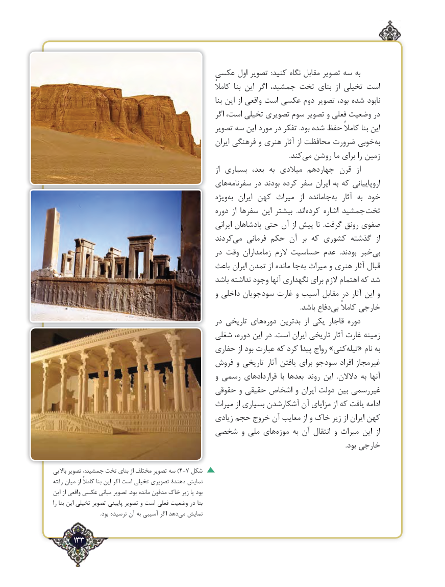

# PDF page 133

عکسی اول تصویر  :کنید نگاه مقابل تصویر سه به
                                                                 کامالً  بنا این اگر جمشید، تخت بنای  از تخیلی است
                                                                     بنا این از واقعی است عکسی دوم تصویر بود، شده نابود
                                                      اگر است، تخیلی تصویری سوم تصویر و فعلی وضعیت در
                                              تصویر سه این مورد در تفکر .بود شده حفظ کامالً بنا این
                                                                   ‌ایران فرهنگی و هنری آثار از محافظت ضرورت خوبیبه‌
                              .‌کندمی روشن ما برای را زمین
                                                                      از بسیاری  بعد،  به میالدی چهاردهم قرن  از
                                      های‌سفرنامه در بودند کرده سفر ایران به که اروپاییانی
                                                     ویژه ‌به  ایران کهن میراث  از  جامانده ‌به  آثار  به خود
                                                 دوره  از سفرها این بیشتر  .اند‌کرده اشاره جمشید  تخت
                                                          ایرانی پادشاهان حتی آن از پیش تا  .گرفت رونق صفوی
                                              کردندمی‌   فرمانی  ‌حکم آن  بر که کشوری گذشته  از
                                               در وقت زمامداران الزم حساسیت عدم  .بودند خبر ‌بی
                                            باعث ایران تمدن از مانده جا ‌به میراث و هنری آثار قبال
                                               باشد نداشته وجود آنها نگهداری برای الزم اهتمام که شد
                                                   و داخلی سودجویان غارت و آسیب مقابل در آثار این و
               .‌باشد دفاع بی کامالً خارجی
                                               در تاریخی های‌دوره بدترین  از یکی قاجار دوره
                                      شغلی دوره، این در  .است ایران تاریخی آثار غارت زمینه
                                        حفاری از بود عبارت که کرد پیدا رواج »کنیتیله‌  « نام به
                                    فروش و تاریخی آثار یافتن برای سودجو افراد غیرمجاز
                                                   و رسمی قراردادهای  با بعدها روند این  .دالالن به آنها
                                       حقوقی و حقیقی اشخاص و ایران دولت بین غیررسمی
                                            میراث از بسیاری آشکارشدن آن مزایای از که یافت ادامه
                                             زیادی حجم خروج آن معایب از و خاک زیر از ایران کهن
                             شخصی و ملی های‌موزه به آن انتقال و میراث این  از
                                                                                                                                                                                    .بود خارجی

باالیی تصویر ،:جمشید تخت بنای از مختلف تصویر سه )4-7 شکل
رفته میان از کامالً بنا این اگر است تخیلی تصویری دهندۀ ‌نمایش
این از واقعی عکسی میانی تصویر .بود مانده مدفون خاک زیر یا بود
را بنا این تخیلی تصویر پایینی تصویر و است فعلی وضعیت در بنا
 .‌بود نرسیده آن به آسیبی اگر دهدمی نمایش

     133٢

