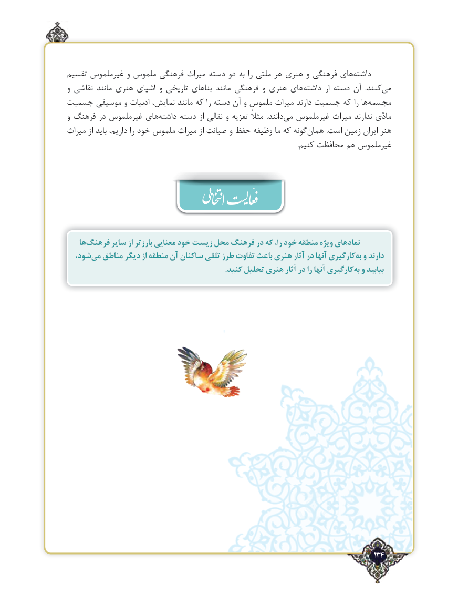

# PDF page 134

تقسیم غیرملموس و ملموس فرهنگی میراث دسته دو به را ملتی هر هنری و فرهنگی های‌داشته
و نقاشی مانند هنری اشیای و تاریخی بناهای مانند فرهنگی و هنری های ‌داشته از دسته آن  .کنندمی‌
جسمیت موسیقی و ادبیات نمایش، مانند که را دسته آن و ملموس میراث دارند جسمیت که را ها‌مجسمه
و فرهنگ در غیرملموس های‌داشته دسته از نقالی و تعزیه مثالً  .دانندمی‌  غیرملموس میراث ندارند مادّی
میراث از باید داریم، را خود ملموس میراث از صیانت و حفظ وظیفه ما که گونههمان‌          .است زمین ‌ایران هنر
                                                                                                                                          .کنیم محافظت هم غیرملموس

    هافرهنگ‌      سایر از بارزتر معنایی خود زیست محل فرهنگ در که را، خود منطقه ویژه نمادهای
  شود،می‌  مناطق دیگر از منطقه آن ساکنان تلقی طرز تفاوت باعث هنری آثار در آنها کارگیریبه‌  و دارند
  .‌کنید تحلیل هنری آثار در را آنها کارگیری  و بیابید                            بهّ

                                                                                   134٢

