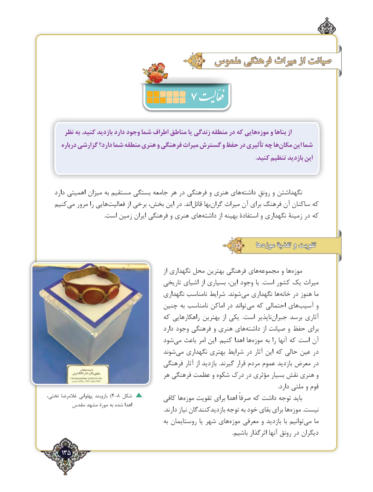

# PDF page 135

ملموسملموس فرهنگیفرهنگی میراثمیراث ازاز صیانتصیانت
                       7
      نظر به .کنید بازدید دارد وجود شما اطراف مناطق یا زندگی منطقه در که هاییموزه‌    و بناها از
      درباره گزارشی دارد؟ شما منطقه هنری و فرهنگی میراث گسترش و حفظ در تأثیری چه هامكان‌    این شما
                                                                                                                                       .کنید تنظیم بازدید این

   دارد اهمیتی میزان به مستقیم بستگی جامعه هر در فرهنگی و هنری های‌داشته رونقِ و نگهداشتن
  کنیممی‌   مرور را هایی‌فعالیت از برخی بخش، این در .اند‌قائل بها ‌گران میراث آن برای فرهنگ آن ساکنان که
                                          .است زمین ‌ایران فرهنگی و هنری هایداشته‌        از بهینه استفادۀ و نگهداری زمینۀ در که

                                                                       هاهاموزه‌‌موزه تغذیۀتغذیۀ وو تقویتتقویت

                                                             از نگهداری محل بهترین فرهنگی هایمجموعه‌        و ها‌موزه
                                       تاریخی اشیای از بسیاری این، وجود با  .است کشور یک میراث
                                       نگهداری نامناسب شرایط  .شوند‌می نگهداری ها‌خانه در هنوز ما
                                چنین به نامناسب اماکن در تواند ‌می که احتمالی های‌آسیب و
                                    که راهکارهایی بهترین از یکی  .است ناپذیر‌جبران برسد آثاری
                                              دارد وجود فرهنگی و هنری های‌داشته از صیانت و حفظ برای
                                 شود ‌می باعث امر این  .کنیم اهدا ها‌موزه به را آنها که است آن
                                     شوند‌می نگهداری بهتری شرایط در آثار این که حالی عین در
                                    فرهنگی آثار از بازدید  .گیرند قرار مردم عموم بازدید معرض در
                                     هر فرهنگی عظمت و شکوه درک در مؤثری بسیار نقش هنری و
                                                                                                                                                                            .دارد ملتی و قوم
،تختی غالمرضا پهلوانی بازوبند )4-8 شکل          کافی ها‌موزه تقویت برای اهدا صرفاً که داشت توجه باید
        مقدس مشهد موزۀ به شده اهدا                                                                                      .دارند نیاز بازدیدکنندگان توجه به خود بقای برای ها ‌موزه .نیست
                                                به روستایمان یا شهر های‌موزه معرفی و بازدید با توانیم‌می ما
                                                                                                                                        .باشیم اثرگذار آنها رونق در دیگران
     135٢

