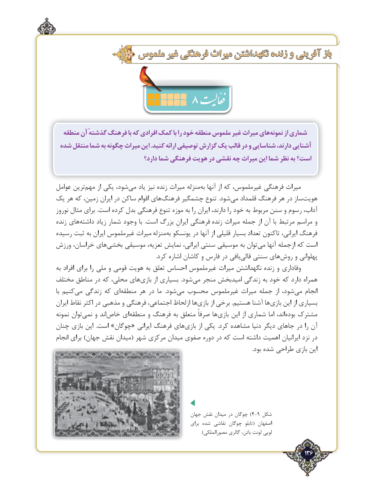

# PDF page 136

ملموس غیر فرهنگی میراث نگهداشتن زنده و آفرینی باز
                      8
  منطقه آن گذشتهٔ فرهنگ با که افرادی کمک با را خود منطقه ملموس غیر میراث هاینمونه‌      از شماری
 شده منتقل شما به چگونه میراث این .کنید ارائه توصیفی گزارش یک قالب در و شناسایی دارند، آشنایی
                                دارد؟ شما فرهنگی هویت در نقشی چه میراث این شما نظر به است؟

عوامل ترین‌مهم از یکی شود،‌می یاد نیز زنده میراث منزلهبه‌  آنها از که غیرملموس، فرهنگی میراث
یک هر که زمین، ‌ایران در ساکن اقوام های‌فرهنگ چشمگیر تنوع .شود‌می قلمداد فرهنگ هر در ساز‌هویت
نوروز مثال برای .است کرده بدل فرهنگی تنوع موزه به را ایران دارند، را خود به مربوط سنن و رسوم آداب،
زنده های‌داشته زیاد شمار وجود با  .است بزرگ ایرانِ فرهنگی زنده میراث جمله از آن با مرتبط مراسم و
رسیده ثبت به ایران غیرملموس میراث منزله‌به یونسکو در آنها از قلیلی بسیار تعداد تاکنون ایرانی، فرهنگ
ورزش خراسان، های ‌بخشی موسیقی تعزیه، نمایش ایرانی، سنتی موسیقی به توان‌می آنها ازجمله که است
                                                                         .کرد اشاره کاشان و فارس در بافی ‌قالی سنتی های‌روش و پهلوانی
به افراد برای را ملی و قومی هویت به تعلق احساس غیرملموس میراث نگهداشتن زنده و وفاداری
مختلف مناطق در که محلی، های‌بازی از بسیاری  .شود ‌می منجر امیدبخش زندگی به خود که دارد همراه
با کنیممی‌   زندگی که ای ‌منطقه هر در ما  .شود‌می محسوب غیرملموس میراث جمله از شود،‌می انجام
ایران نقاط اکثر در مذهبی و فرهنگی اجتماعی، ازلحاظ هابازی‌      از برخی .هستیم آشنا ها‌بازی این از بسیاری
نمونه توان‌نمی و اندخاص‌    ای‌منطقه و فرهنگ به متعلق صرفاً ها ‌بازی این از شماری اما اند،‌بوده مشترک
چنان بازی این  .است »چوگان« ایرانی فرهنگ های‌بازی از یکی  .کرد مشاهده دنیا دیگر جاهای در را آن
انجام برای )جهان ‌نقش میدان( شهر مرکزی میدان صفوی دوره در که است داشته اهمیت ایرانیان نزد در
                                                                                                                                                .بود شده طراحی بازی این

                                                  جهان نقش میدان در چوگان )4-9 شکل
                                                               برای شده  ‌نقاشی چوگان  تابلو( اصفهان
                                                                                 )مصورالملکی گالری باتن، لونت لویی

                                                                                   136٢

