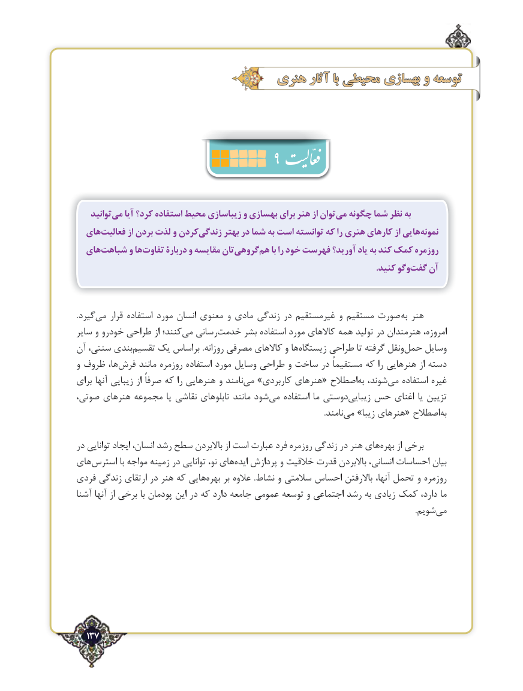

# PDF page 137

هنریهنری آثارآثار بابا محیطیمحیطی بهسازیبهسازی وو توسعهتوسعه

                                      9

    توانیدمی‌   آیا كرد؟ استفاده محیط زیباسازی و بهسازی برای هنر از توانمی‌  چگونه شما نظر به
  هایفعالیت‌        از بردن ‌لذت و كردنزندگی‌      بهتر در شما به است توانسته كه را هنری كارهای از هایینمونه‌
  هایشباهت‌      و هاتفاوت‌      دربارۀ و مقایسه تانگروهی‌    هم‌    با را خود فهرست آورید؟ یاد به كند كمک روزمره
                .‌كنید وگوگفت آن

.گیردمی‌    قرار استفاده مورد انسان معنوی و مادی زندگی در غیرمستقیم و مستقیم صورت  به هنر
سایر و خودرو طراحی از کنند؛می‌   رسانی‌خدمت بشر استفاده مورد کاالهای همه تولید در هنرمندان امروزه،
آن سنتی، بندی ‌تقسیم یک براساس .روزانه مصرفی کاالهای و هازیستگاه‌      طراحی تا گرفته ونقل‌حمل وسایل
و ظروف ها،‌فرش مانند روزمره استفاده مورد وسایل طراحی و ساخت در مستقیماً که را هنرهایی از دسته
برای آنها زیبایی از صرفاً که را هنرهایی و نامند ‌می »کاربردی هنرهای« اصطالح ‌به شوند، ‌می استفاده غیره
صوتی، هنرهای مجموعه یا نقاشی تابلوهای مانند شود‌می استفاده ما دوستیزیبایی‌   حس اغنای یا تزیین
                      .‌نامند می »زیبا هنرهای« اصطالح‌به

در توانایی ایجاد انسان، رشد سطح باالبردن از است عبارت فرد روزمره زندگی در هنر های‌بهره از برخی
های‌استرس با مواجه زمینه در توانایی نو، های‌ایده پردازش و خالقیت قدرت باالبردن انسانی، احساسات بیان
فردی زندگی ارتقای در هنر که هایی‌بهره بر عالوه  .نشاط و سالمتی احساس باالرفتن آنها، تحمل و روزمره
آشنا آنها از برخی با پودمان این در که دارد جامعه عمومی توسعه و اجتماعی رشد به زیادی کمک دارد، ما
                             .‌شویم می

  137٢

