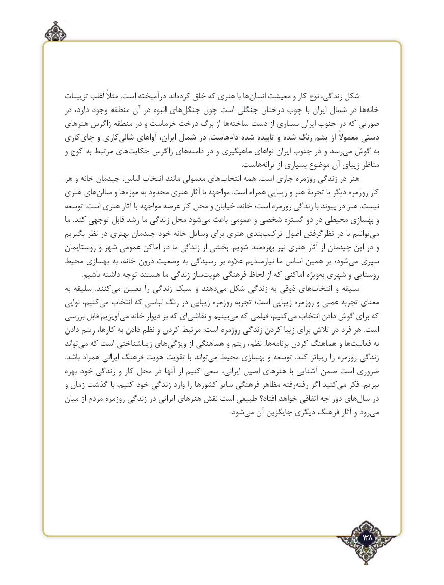

# PDF page 138

تزیینات اغلب مثالً .است درآمیخته اندکرده‌   خلق که هنری با ها ‌انسان معیشت و کار نوع زندگی، شکل
در دارد، وجود منطقه آن در انبوه های ‌جنگل چون است جنگلی درختان چوب  با ایران شمال در ها ‌خانه
هنرهای زاگرس منطقه در و خرماست درخت برگ از ها‌ساخته ‌دست از بسیاری ایران جنوب در که صورتی
کاری‌چای و کاری‌شالی آواهای ایران، شمال در  .هاست ‌دام شده‌ تابیده و شده ‌ رنگ پشم از معموالً دستی
و کوچ به مرتبط های ‌حکایت زاگرس های ‌دامنه در و ماهیگیری نواهای ایران جنوب در و رسد ‌می گوش به
                .‌هاست ترانه از بسیاری موضوع آن زیبای مناظر
هر و خانه چیدمان لباس، انتخاب مانند معمولی های ‌انتخاب همه  .است جاری روزمره زندگی در هنر
هنری های ‌سالن و ها‌موزه به محدود هنری آثار با مواجهه .است همراه زیبایی و هنر تجربۀ با دیگر روزمره کار
توسعه .است هنری آثار با مواجهه عرصه کار محل و خیابان خانه، است؛ روزمره زندگی با پیوند در هنر .نیست
ما  .کند توجهی قابل رشد ما زندگی محل شود‌می باعث عمومی و شخصی گستره دو در محیطی بهسازی و
بگیریم نظر در بهتری چیدمان خود خانه وسایل برای هنری بندی‌ترکیب اصول نظرگرفتن در با توانیم ‌می
روستایمان و شهر عمومی اماکن در ما زندگی از بخشی  .شویم مند ‌بهره نیز هنری آثار از چیدمان این در و
محیط بهسازی به خانه، درون وضعیت به رسیدگی بر عالوه نیازمندیم ما اساس همین بر شود؛‌می سپری
.‌باشیم داشته توجه هستند ما زندگی سازهویت فرهنگی لحاظ از که اماکنی ویژهبه‌ شهری و روستایی
به سلیقه  .کنندمی‌   تعیین را زندگی سبک و دهندمی‌  شکل زندگی به ذوقی های‌انتخاب و سلیقه
نوایی کنیم،می‌   انتخاب که لباسی رنگ در زیبایی روزمره تجربه است؛ زیبایی روزمره و عملی تجربه معنای
بررسی قابل آویزیم‌می خانه دیوار بر که ای‌نقاشی و بینیممی‌  که فیلمی کنیم،می‌   انتخاب دادن ‌گوش برای که
دادن‌ ریتم کارها، به دادن‌ نظم و کردن‌ مرتبط  :است روزمره زندگی کردن زیبا برای تالش در فرد هر  .است
تواند ‌می که است زیباشناختی های‌ویژگی از هماهنگی و ریتم نظم،  .ها‌برنامه کردن ‌هماهنگ و ها ‌فعالیت به
.باشد همراه ایرانی فرهنگ هویت تقویت با تواند‌می محیط بهسازی و توسعه  .کند زیباتر را روزمره زندگی
بهره خود زندگی و کار محل در آنها از کنیم سعی ایرانی، اصیل هنرهای  با آشنایی ضمن است ضروری
و زمان گذشت با کنیم، خود زندگی وارد را کشورها سایر فرهنگی مظاهر رفته‌رفته اگر کنیدمی‌   فکر  .ببریم
میان از مردم روزمره زندگی در ایرانی هنرهای نقش است طبیعی افتاد؟ خواهد اتفاقی چه دور های‌سال در
                    .‌شود می آن جایگزین دیگری فرهنگ آثار و رود ‌می

                                                                                   138٢

