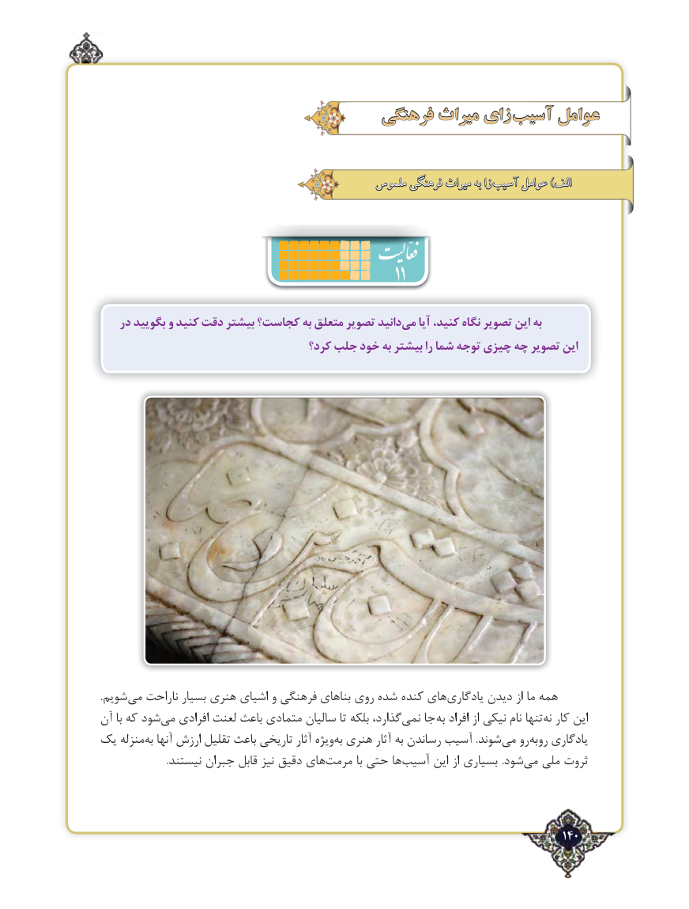

# PDF page 140

فرهنگی میراث زای آسیب عوامل

                                            ملموس فرهنگی میراث به زا آسیب عوامل )الف

                                                       11
   در بگویید و كنید دقت بیشتر كجاست؟ به متعلق تصویر دانیدمی‌   آیا ‌،كنید نگاه تصویر این به
                                    كرد؟ جلب خود به بیشتر را شما توجه چیزی چه‌  تصویر این

.شویم‌می ناراحت بسیار هنری اشیای و فرهنگی بناهای روی شده ‌کنده های ‌یادگاری دیدن از ما همه
آن با که شود ‌می افرادی لعنت باعث متمادی سالیان تا بلکه گذارد،نمی‌   جا  به افراد از نیکی نام تنها‌نه کار این
یک منزله ‌به آنها ارزش تقلیل باعث تاریخی آثار ویژه ‌به هنری آثار به رساندن ‌آسیب .شوند ‌می رو‌روبه یادگاری
                          .نیستند جبران قابل نیز دقیق هایمرمت‌         با حتی ها‌آسیب این از بسیاری .شود ‌می ملی ثروت

                                                                                   140٢

