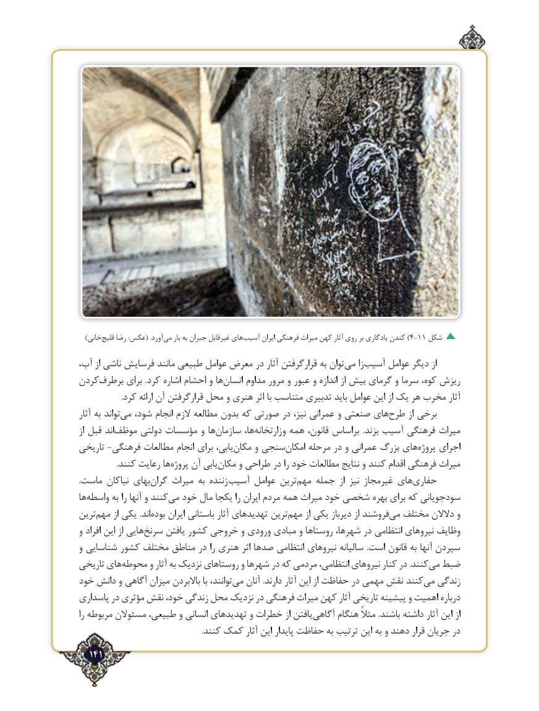

# PDF page 141

)خانی‌قلیچ رضا :عکس( .آورد‌می بار به جبران غیرقابل های‌)آسیب ایران فرهنگی میراث کهن آثار روی بر یادگاری کندن 4-11 شکل
،توانآب از ناشی فرسایش مانند طبیعی عوامل معرض در آثار قرارگرفتن به   می‌    زاآسیب‌     عوامل دیگر از
کردنبرطرف‌      برای .کرد اشاره احشام و هاانسان‌     مداوم مرور و عبور و اندازه از بیش گرمای و سرما کوه، ریزش
                             ‌.کرد ارائه آن قرارگرفتن محل و هنری اثر با متناسب تدبیری باید عوامل این از یک هر مخرب آثار
آثار به تواندمی‌   شود، انجام الزم مطالعه بدون که صورتی در نیز، عمرانی و صنعتی هایطرح‌      از برخی
از قبل اندموظف‌     دولتی مؤسسات و هاسازمان‌        ها،وزارتخانه‌      همه قانون، براساس  .بزند آسیب فرهنگی میراث
تاریخی ‌-فرهنگی مطالعات انجام برای یابی،مکان‌     و سنجیامکان‌    مرحله در و عمرانی بزرگ هایپروژه‌    اجرای
 .‌کنند رعایت هاپروژه آن یابیمکان‌     و طراحی در را خود مطالعات نتایج و کنند اقدام فرهنگی میراث
.ماست نیاکان بهایگران‌    میراث به زننده ‌آسیب عوامل ترینمهم‌   جمله  از نیز غیرمجاز هایحفاری‌
هاواسطه‌      به را آنها و کنندمی‌  خود مال یکجا را ایران مردم همه میراث خود شخصی بهره برای که سودجویانی
ترینمهم‌     از یکی .اندبوده‌    ایران باستانی آثار تهدیدهای ترینمهم‌     از یکی دیرباز از فروشندمی‌  مختلف دالالن و
و افراد این از هاییسرنخ‌     یافتن کشور خروجی و ورودی مبادی و روستاها شهرها، در انتظامی نیروهای وظایف
و شناسایی کشور مختلف مناطق در را هنری اثر صدها انتظامی نیروهای سالیانه  .است قانون به آنها سپردن
تاریخی هایمحوطه‌      و آثار به نزدیک روستاهای و شهرها در که مردمی انتظامی، نیروهای کنار در .کنندمی‌  ضبط
خود دانش و آگاهی میزان باالبردن با توانند،می‌   آنان .دارند آثار این از حفاظت در مهمی نقش کنندمی‌  زندگی
پاسداری در مؤثری نقش خود، زندگی محل نزدیک در فرهنگی میراث کهن آثار تاریخی پیشینه و اهمیت درباره
را مربوطه مسئوالن طبیعی، و انسانی تهدیدهای و خطرات از یافتنآگاهی‌     هنگام مثالً .باشند داشته آثار این از
                                                              .کنند کمک آثار این پایدار حفاظت به ترتیب این به و دهند قرار جریان در
  141٢

