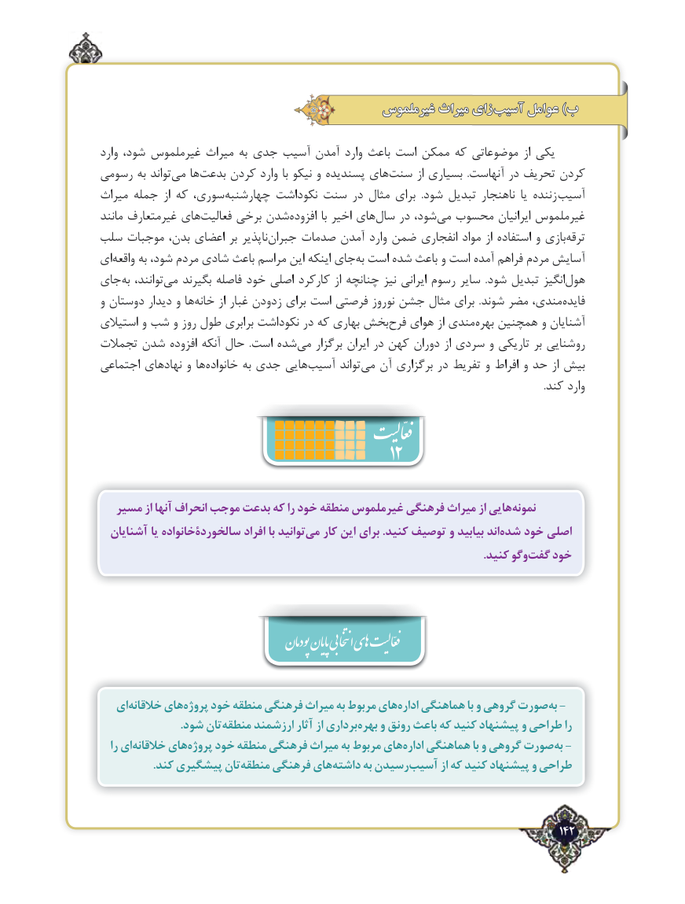

# PDF page 142

غیرملموس میراث زای  آسیب عوامل )ب

وارد شود، غیرملموس میراث به جدی آسیب آمدن وارد باعث است ممکن که موضوعاتی از یکی
رسومی به تواند ‌می ها‌بدعت کردن وارد با نیکو و پسندیده های‌سنت از بسیاری  .آنهاست در تحریف کردن
میراث جمله  از که سوری، ‌چهارشنبه نکوداشت سنت در مثال برای  .شود تبدیل ناهنجار  یا زننده‌ آسیب
مانند غیرمتعارف های‌فعالیت برخی شدن‌افزوده با اخیر های‌سال در شود،‌می محسوب ایرانیان غیرملموس
سلب موجبات بدن، اعضای بر ناپذیر ‌جبران صدمات آمدن وارد ضمن انفجاری مواد از استفاده و بازی‌ترقه
ای ‌واقعه به شود، مردم شادی باعث مراسم این اینکه جای‌به است شده باعث و است آمده‌فراهم مردم آسایش ‌
جای‌به توانند،‌می بگیرند فاصله خود اصلی کارکرد از چنانچه نیز ایرانی رسوم سایر  .شود تبدیل انگیزهول‌
و دوستان دیدار و ها ‌خانه از غبار زدودن برای است فرصتی نوروز جشن مثال برای  .شوند مضر مندی، ‌فایده
استیالی و شب و روز طول برابری نکوداشت در که بهاری بخش‌فرح هوای از مندی‌بهره همچنین و آشنایان
تجمالت شدن‌ افزوده آنکه حال  .است شده‌می برگزار ایران در کهن دوران از سردی و تاریکی بر روشنایی
اجتماعی نهادهای و ها ‌خانواده به جدی هاییآسیب‌       تواند ‌می آن برگزاری در تفریط و افراط و حد از بیش
                                                                                                                                                                                  .کند وارد
                                             12
  مسیر از آنها انحراف موجب بدعت که را خود منطقه غیرملموس فرهنگی میراث از هایینمونه‌
  آشنایان یا سالخوردۀخانواده افراد با توانیدمی‌   کار این برای .کنید توصیف و بیابید اندشده‌   خود اصلی
                .‌کنید وگوگفت خود

                                              پودمان پایان انتخابی اهی  فعّالیت

   ایخالقانه‌     هایپروژه‌    خود منطقه فرهنگی میراث به مربوط هایاداره‌   هماهنگی با و گروهی صورتبه‌ -
                            .شود تانمنطقه‌     ارزشمند آثار از برداریبهره‌    و رونق باعث که کنید پیشنهاد و طراحی را
   را ایخالقانه‌     هایپروژه‌    خود منطقه فرهنگی میراث به مربوط هایاداره‌   هماهنگی با و گروهی صورتبه‌ -
                   .کند پیشگیری تانمنطقه‌    فرهنگی هایداشته‌      به رسیدنآسیب‌       از که کنید پیشنهاد و طراحی

                                                                                   142٢

