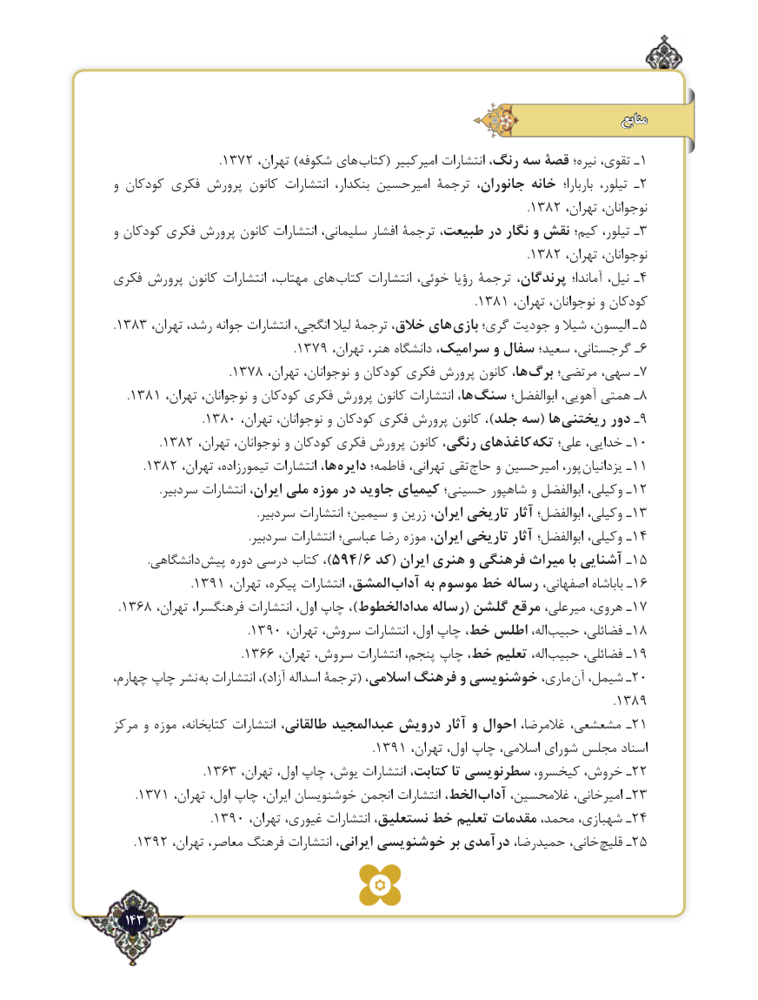

# PDF page 143

منابع
                                      .١٣٧٢ ،هایتهران )شکوفه       کتاب١( امیرکبیر انتشارات رنگ، سه قصۀ نیره؛ تقوی، ـ
و کودکان فکری پرورش کانون انتشارات بنکدار، امیرحسین ترجمۀ جانوران، خانه  باربارا؛ تیلور، ـ2
                                                            .1382 ،نوجوانان،تهران
و کودکان فکری پرورش کانون انتشارات سلیمانی، افشار ترجمۀ طبیعت، در نگار و نقش کیم؛ تیلور، ـ3
                                                            .1382 ،نوجوانان،تهران
فکری پرورش کانون انتشارات مهتاب، های  کتاب انتشارات خوئی، رؤیا ترجمۀ پرندگان، آماندا؛ نیل، ـ4
                                                    .1381 ،کودکانتهران نوجوانان، و
.1383 ،هایتهران رشد، جوانه انتشارات انگجی، لیال ترجمۀ خالق،        بازی گری؛ جودیت و شیال الیسون، ـ 5
                          .1379 ،ـتهران هنر، دانشگاه سرامیک، و سفال سعید؛ گرجستانی، 6
                 .1378 ،ها،تهران نوجوانان، و کودکان فکری پرورش کانون      برگ مرتضی؛ سهی، ـ7
  .1381 ،ها،تهران نوجوانان، و کودکان فکری پرورش کانون انتشارات      سنگ ابوالفضل؛ آهویی، همتی ـ8
             .1380 ،هاتهران نوجوانان، و کودکان فکری پرورش کانون ،)جلد سه(     ریختنی  دور ـ9
       .1382 ،کاغذهایتهران نوجوانان، و کودکان فکری پرورش کانون رنگی،                تکه علی؛ خدایی، ـ10
    .1382 ،ها،تهران تیمورزاده، انتشارات      دایره فاطمه؛ تهرانی، تقی حاج و امیرحسین پور، یزدانیان ـ11
                 .سردبیر انتشارات ایران، ملی موزه در جاوید کیمیای حسینی؛ شاهپور و ابوالفضل وکیلی، ـ12
                                                    .سردبیر انتشارات سیمین؛ و زرین ایران، تاریخی آثار ابوالفضل؛ وکیلی، ـ13
                                                 .سردبیر انتشارات عباسی؛ رضا موزه ایران، تاریخی آثار ابوالفضل؛ وکیلی، ـ14
            .دانشگاهی  )پیش دوره درسی کتاب ، 594/6 کد( ایران هنری و فرهنگی میراث با آشنایی ـ15
           .1391 ،المشق،تهران پیکره، انتشارات              آداب به موسوم خط رساله اصفهانی، باباشاه ـ 16
 .1368 ،ـتهران فرهنگسرا، انتشارات اول، چاپ ، )مدادالخطوط رساله( گلشن مرقع میرعلی، هروی، 17
                   .1390 ،اله،تهران سروش، انتشارات اول، چاپ خط، اطلس      حبیب فضائلی، ـ18
                   .1366 ،اله،تهران سروش، انتشارات پنجم، چاپ خط، تعلیم      حبیب فضائلی، ـ19
،نشرچهارم چاپ      به انتشارات ،)آزاد اسداله ترجمۀ( اسالمی، فرهنگ و خوشنویسی ماری،  آن شیمل، ـ20
                                                                        .1389
مرکز و موزه کتابخانه، انتشارات طالقانی، عبدالمجید درویش آثار و احوال غالمرضا، مشعشعی، ـ21
                                     .1391 ،اسنادتهران اول، چاپ اسالمی، شورای مجلس
             .1363 ،ـتهران اول، چاپ یوش، انتشارات کتابت، تا سطرنویسی کیخسرو، خروش، 22
   .1371 ،الخط،تهران اول، چاپ ایران، خوشنویسان انجمن انتشارات           آداب غالمحسین، امیرخانی، ـ23
              .1390 ،ـتهران غیوری، انتشارات نستعلیق، خط تعلیم مقدمات محمد، شهبازی، 24
   .1392 ،خانی،تهران معاصر، فرهنگ انتشارات ایرانی، خوشنویسی بر درآمدی حمیدرضا،         قلیچ ـ25

  143٢

