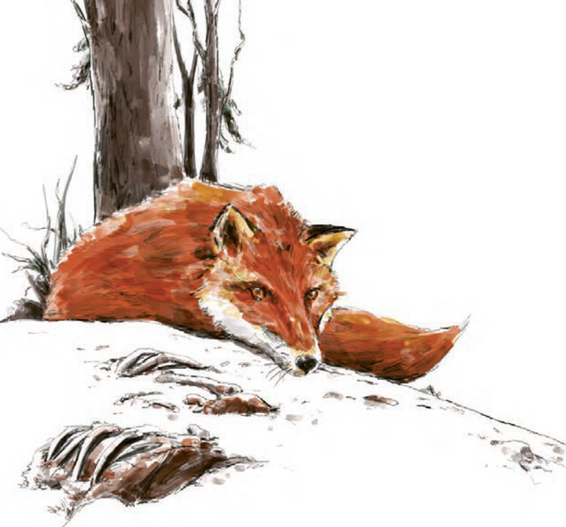

# صفحه ۱۳

بگیر ای جوان، دست درویش پیر  
نه خود را بیفکن که دستم بگیر

خدا را بر آن بنده بخشایش است  
که خلق از وجودش در آسایش است

کرم ورز و آن سر که مغزی در اوست  
که دون‌همتانند بی‌مغز و پوست

کسی نیک بیند به هر دو سرای  
که نیکی رساند به خلق خدای

بوستان، سعدی
