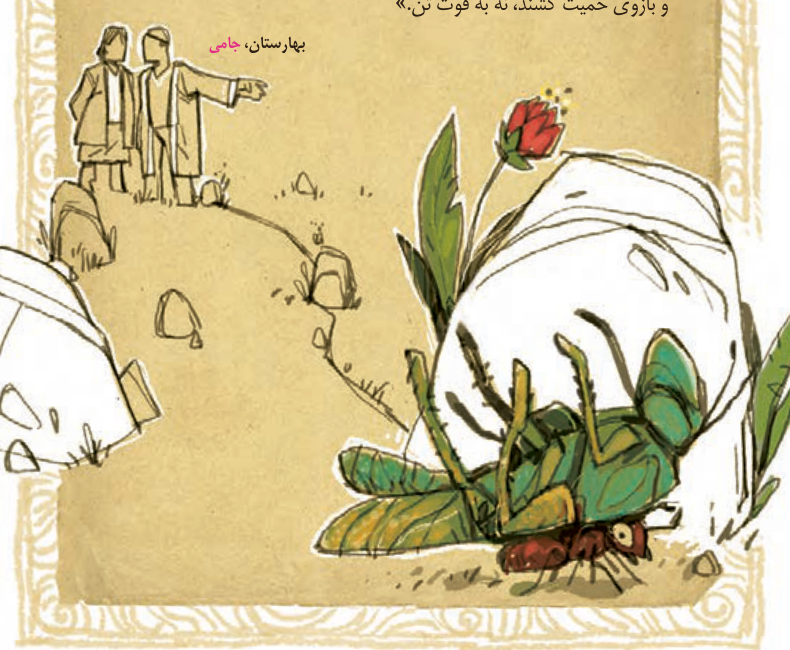

# صفحه ۱۶

## گنج حکمت: همّت

موری را دیدند که به زورمندی کمر بسته و ملخی را ده برابر خود برداشته. به تعجّب گفتند: «این مور را ببینید که [بار] به این گرانی چون می‌کشد؟»

مور چون این بشنید، بخندید و گفت: «مردان، بار را به نیروی همّت و بازوی حمیّت کشند، نه به قوّت تن.»

بهارستان، جامی

