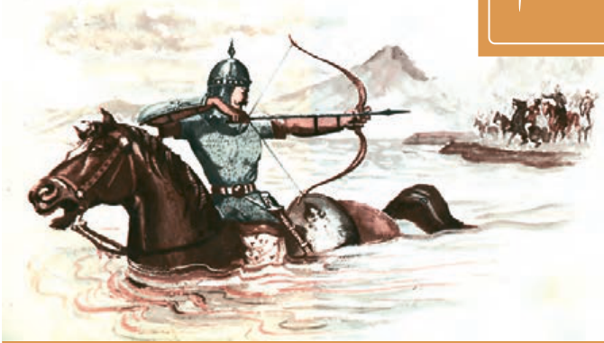

# صفحه ۲۸

## درس سوم: در امواج سند

به مغرب، سینه‌مالان قرص خورشید  
نهان می‌گشت پشت کوهساران

فرو می‌ریخت گردی زعفران‌رنگ  
به روی نیزه‌ها و نیزه‌داران

***

ز هر سو بر سواری غلت می‌خورد  
تن سنگین اسبی تیرخورده

به زیر باره می‌نالید از درد  
سوار زخم‌دار نیم‌مرده

***

نهان می‌گشت روی روشن روز  
به زیر دامن شب در سیاهی

در آن تاریک شب می‌گشت پنهان  
فروغ خرگه خوارزمشاهی
