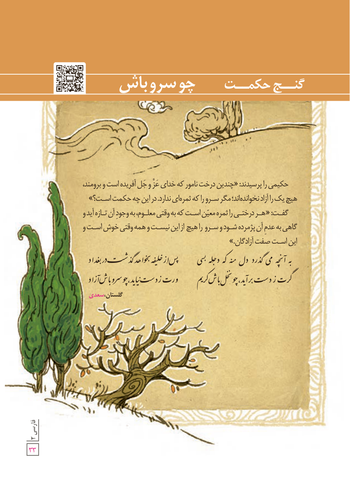

# گنج حکمت: چو سرو باش

حکیمی را پرسیدند: «چندین درخت نامور که خدای عزّ و جلّ آفریده است و برومند، هیچ یک را آزاد نخوانده‌اند؛ مگر سرو را که ثمره‌ای ندارد. در این چه حکمت است؟»

گفت: «هر درختی را ثمرۀ معیّن است که به وقتی معلوم، به وجود آن تازه آید و گاهی به عدم آن پژمرده شود و سرو را هیچ از این نیست و همه وقتی خوش است و این است صفت آزادگان.»

به آنچه می‌گذرد دل منه که دجله بسی　　پس از خلیفه بخواهد گذشت در بغداد  
گرت ز دست برآید چو نخل باش کریم　　ورت ز دست نیاید چو سرو باش آزاد

گلستان، سعدی

۳۳
