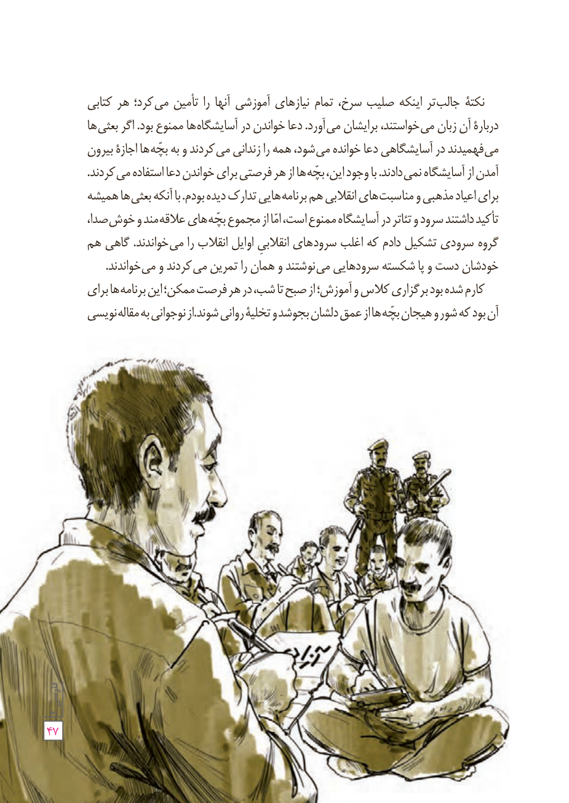

نکتۀ جالب‌تر اینکه صلیب سرخ، تمام نیازهای آموزشی آنها را تأمین می‌کرد؛ هر کتابی دربارۀ آن زبان می‌خواستند، برایشان می‌آورد. دعا خواندن در آسایشگاه‌ها ممنوع بود. اگر بعثی‌ها می‌فهمیدند در آسایشگاهی دعا خوانده می‌شود، همه را زندانی می‌کردند و به بچّه‌ها اجازۀ بیرون آمدن از آسایشگاه نمی‌دادند. با وجود این، بچّه‌ها از هر فرصتی برای خواندن دعا استفاده می‌کردند. برای اعیاد مذهبی و مناسبت‌های انقلابی هم برنامه‌هایی تدارک دیده بودم. با آنکه بعثی‌ها همیشه تأکید داشتند سرود و تئاتر در آسایشگاه ممنوع است، امّا از مجموع بچّه‌های علاقه‌مند و خوش‌صدا، گروه سرودی تشکیل دادم که اغلب سرودهای انقلابی اوایل انقلاب را می‌خواندند. گاهی هم خودشان دست و پا شکسته سرودهایی می‌نوشتند و همان را تمرین می‌کردند و می‌خواندند.

کارم شده بود برگزاری کلاس و آموزش؛ از صبح تا شب، در هر فرصت ممکن؛ این برنامه‌ها برای آن بود که شور و هیجان بچّه‌ها از عمق دلشان بجوشد و تخلیۀ روانی شوند. از نوجوانی به مقاله‌نویسی

۴۷
