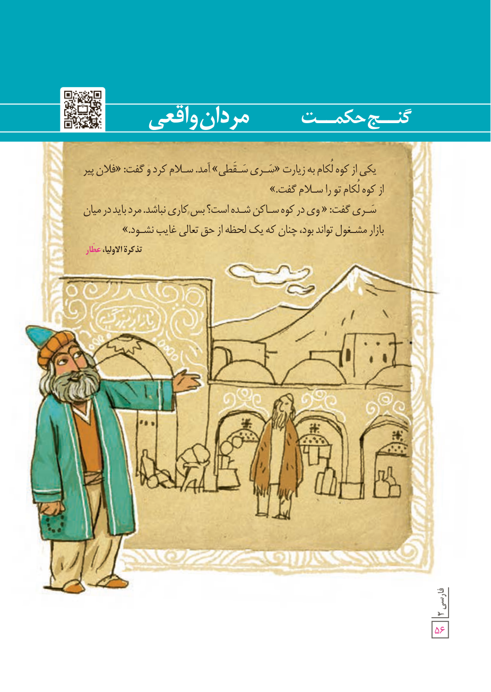

# گنج حکمت: مردان واقعی

یکی از کوه لُکام به زیارت «سَری سَقَطی» آمد. سلام کرد و گفت: «فلان پیر از کوه لُکام تو را سلام گفت.»

سَری گفت: «وی در کوه ساکن شده است؟ پس کاری نباشد. مرد باید در میان بازار مشغول تواند بود، چنان که یک لحظه از حق تعالی غایب نشود.»

تذکرةالاولیا، عطّار

۵۶
