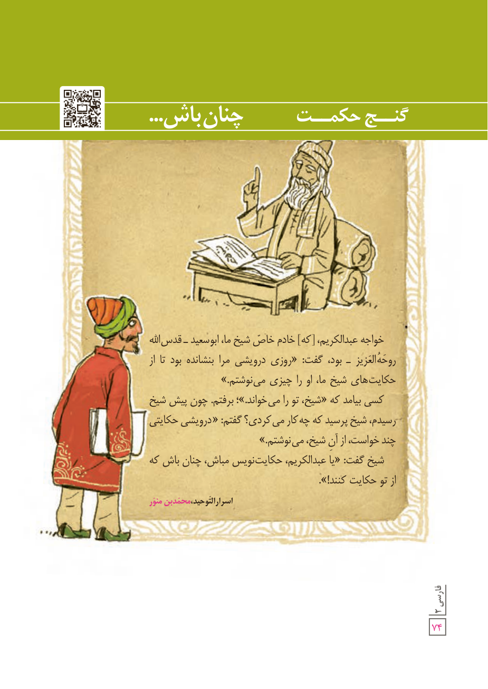

# گنج حکمت: چنان باش...

خواجه عبدالکریم، [که] خادم خاصّ شیخ ما، ابوسعید ـ قدّس‌الله روحَهُ العزیز ـ بود، گفت: «روزی درویشی مرا بنشانده بود تا از حکایت‌های شیخ ما، او را چیزی می‌نوشتم.»

کسی بیامد که «شیخ، تو را می‌خواند.» برفتم. چون پیش شیخ رسیدم، شیخ پرسید که چه کار می‌کردی؟ گفتم: «درویشی حکایتی چند خواست، از آن شیخ، می‌نوشتم.»

شیخ گفت: «یا عبدالکریم، حکایت‌نویس مباش، چنان باش که از تو حکایت کنند!». 

اسرارالتّوحید، محمّد بن منوّر
