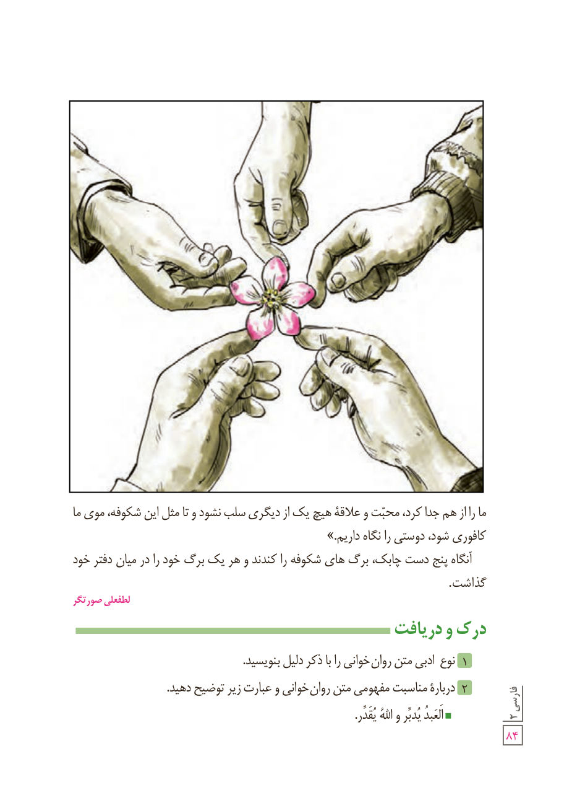

ما را از هم جدا کرد، محبّت و علاقۀ هیچ یک از دیگری سلب نشود و تا مثل این شکوفه، موی ما کافوری شود، دوستی را نگاه داریم.»

آنگاه پنج دست چابک، برگ‌های شکوفه را کندند و هر یک برگ خود را در میان دفتر خود گذاشت.

لطف‌علی صورتگر

## درک و دریافت

۱ نوع ادبی متن روان‌خوانی را با ذکر دلیل بنویسید.

۲ دربارۀ مناسبت مفهومی متن روان‌خوانی و عبارت زیر توضیح دهید.

الْعَبْدُ یُدَبِّرُ وَ اللّٰهُ یُقَدِّرُ.
