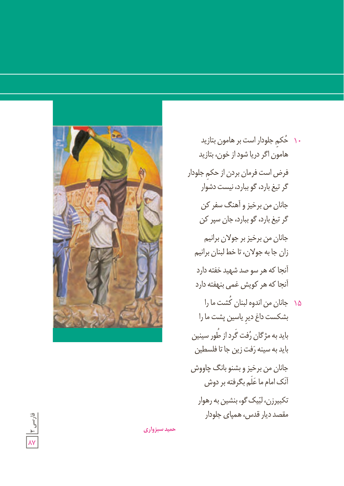

۱۰ حُکم جلودار است بر هامون بتازید  
هامون اگر دریا شود از خون، بتازید

فرض است فرمان بردن از حکم جلودار  
گر تیغ بارد، گو ببارد، نیست دشوار

جانان من برخیز و آهنگ سفر کن  
گر تیغ بارد، گو ببارد، جان سپر کن

جانان من برخیز بر جولان برانیم  
زان جا به جولان، تا خط لبنان برانیم

آنجا که هر سو صد شهید خفته دارد  
آنجا که هر کویش غمی بنهفته دارد

۱۵ جانان من اندوه لبنان کُشت ما را  
بشکست داغ دیر یاسین پشت ما را

باید به مژگان رُفت گرد از طور سینین  
باید به سینه رَفت زین جا تا فلسطین

جانان من برخیز و بشنو بانگ چاووش  
آنک امام ما عَلَم بگرفته بر دوش

تکبیرزن، لبّیک گو، بنشین به رهوار  
مقصد دیار قدس، همپای جلودار

حمید سبزواری
