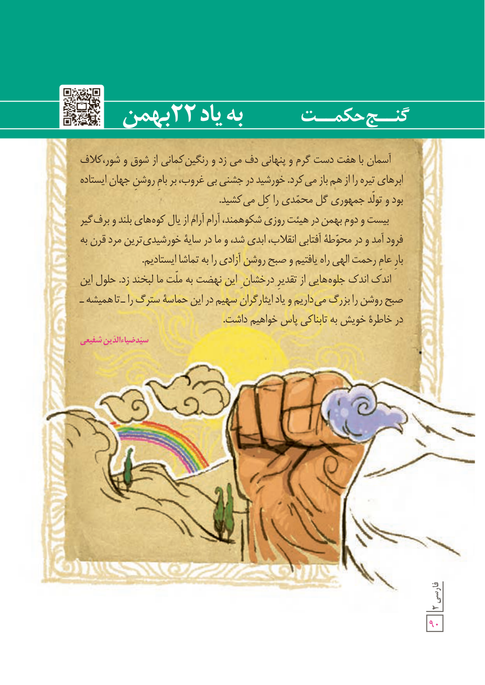

# گنج حکمت: به یاد ۲۲ بهمن

آسمان با هفت دست گرم و پنهانی دف می‌زد و رنگین کمانی از شوق و شور، کلاف ابرهای تیره را از هم باز می‌کرد. خورشید در جشنی بی‌غروب، بر بام روشن جهان ایستاده بود و تولّد جمهوری گل محمّدی را کل می‌کشید.

بیست و دوم بهمن در هیئت روزی شکوهمند، آرام آرام از یال کوه‌های بلند و برف‌گیر فرود آمد و در محوطۀ آفتابی انقلاب، ابدی شد، و ما در سایۀ خورشیدی‌ترین مرد قرن به بار عام رحمت الهی راه یافتیم و صبح روشن آزادی را به تماشا ایستادیم.

اندک اندک جلوه‌هایی از تقدیر درخشان این نهضت به ملّت ما لبخند زد. حلول این صبح روشن را بزرگ می‌داریم و یاد ایثارگران سهیم در این حماسۀ سترگ را ـ تا همیشه ـ در خاطرۀ خویش به تابناکی پاس خواهیم داشت.

سیّد ضیاءالدّین شفیعی

