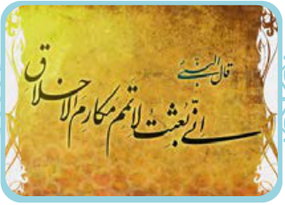

قَدْ یَکُونُ بَیْنَ النّاسِ مَنْ هُوَ أَحْسَنُ مِنّا،

فَعَلَیْنا أَنْ نَبْتَعِدَ عَنِ الْعُجْبِ وَ أَنْ لا نَذْکُرَ عُیُوبَ الْآخَرینَ بِکَلامٍ خَفِیٍّ أَوْ بِإِشارَةٍ.

فَقَدْ قالَ أَمیرُ الْمُؤْمِنینَ عَلِیٌّ عَلَیْهِ السَّلامُ:

«أَکْبَرُ الْعَیْبِ أَنْ تَعیبَ ما فیکَ مِثْلُهُ».

تَنْصَحُنا الْآیَةُ الْأُولیٰ وَ تَقُولُ:

لا تَعیبُوا الْآخَرینَ. وَ لا تُلَقِّبُوهُمْ بِأَلْقابٍ یَکْرَهُونَها.

بِئْسَ الْعَمَلُ الْفُسُوقُ! وَ مَنْ یَفْعَلْ ذٰلِکَ وَ لَمْ یَتُبْ فَهُوَ مِنَ الظّالِمینَ.
