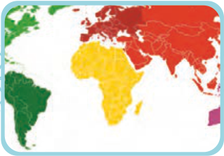
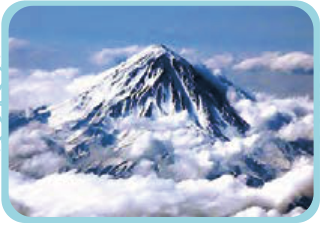

# اِعْلَمُوا
## اِسْمُ التَّفْضیلِ وَ اسْمُ الْمَکانِ

■ اسم تفضیل مفهوم برتری دارد و بر وزن «أَفْعَل» است.

اسم تفضیل معادل «صفت برتر» و «صفت برترین» در زبان فارسی است؛ مثال:

کَبیر: بزرگ، أَکْبَر: بزرگ‌تر، بزرگ‌ترین؛ حَسَن: خوب، أَحْسَن: خوب‌تر، خوب‌ترین

آسیا أَکْبَرُ مِنْ أُورُوبّا. — آسیا بزرگ‌تر از اروپاست.

آسیا أَکْبَرُ قارّاتِ الْعالَمِ. — آسیا بزرگ‌ترین قارّه‌های جهان است.

آسیا أَکْبَرُ قارَّةٍ فِی الْعالَمِ. — آسیا بزرگ‌ترین قارّه در جهان است.

جَبَلُ دَماوَنْد أَعْلیٰ مِنْ جَبَلِ دِنا. — کوه دماوند بلندتر از کوه دناست.

جَبَلُ دَماوَنْد أَعْلیٰ جِبالِ ایران. — کوه دماوند بلندترین کوه‌های ایران است.

جَبَلُ دَماوَنْد أَعْلیٰ جَبَلٍ فی ایران. — کوه دماوند بلندترین کوه در ایران است.

