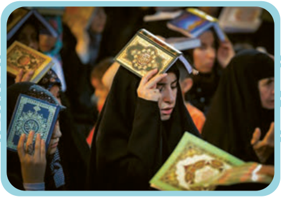

# اِخْتَبِرْ نَفْسَکَ: تَرْجِمِ الْعِباراتِ التّالِیَةَ.

۱. ﴿... رَبَّنا آمَنّا فَاغْفِرْ لَنا وَ ارْحَمْنا وَ أَنْتَ خَیْرُ الرّاحِمینَ﴾ الْمُؤْمِنُون: ۱۰۹

۲. خَیْرُ إِخْوانِکُمْ مَنْ أَهْدیٰ¹ إِلَیْکُمْ عُیُوبَکُمْ. رَسُولُ اللّٰهِ صَلَّی اللّٰهُ عَلَیْهِ وَ آلِهِ

۳. شَرُّ النّاسِ ذُو الْوَجْهَیْنِ.

۴. ﴿لَیْلَةُ الْقَدْرِ خَیْرٌ مِنْ أَلْفِ شَهْرٍ﴾ الْقَدْر: ۳

۱ـ أَهْدیٰ: هدیه کرد
