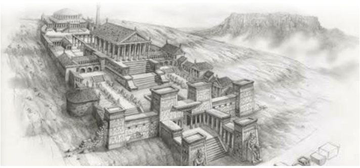

■ اسم مکان بر مکان دلالت دارد و بیشتر بر وزن مَفْعَل و گاهی بر وزن مَفْعِل و مَفْعَلَة است؛ مثال:

مَلْعَب: ورزشگاه؛ مَطْعَم: رستوران؛ مَصْنَع: کارخانه؛ مَطْبَخ: آشپزخانه

مَوْقِف: ایستگاه؛ مَنْزِل: خانه؛ مَکْتَبَة: کتابخانه؛ مَطْبَعَة: چاپخانه

■ جمع اسم مکان بر وزن «مَفاعِل» است؛ مانند: مَدارِس، مَلاعِب، مَطاعِم و مَنازِل.

# اِخْتَبِرْ نَفْسَکَ: تَرْجِمِ الْآیَتَیْنِ وَ الْعِبارَةَ، ثُمَّ عَیِّنِ اسْمَ الْمَکانِ وَ اسْمَ التَّفْضیلِ.

۱. ﴿... وَ جادِلْهُمْ¹ بِالَّتی هِیَ أَحْسَنُ إِنَّ رَبَّکَ هُوَ أَعْلَمُ بِمَنْ ضَلَّ² عَنْ سَبیلِهِ ...﴾ النَّحْل: ۱۲۵

۲. ﴿وَ الْآخِرَةُ خَیْرٌ وَ أَبْقیٰ﴾ الْأَعْلیٰ: ۱۷

۳. کانَتْ مَکْتَبَةُ «جُنْدِیسابور» فی خوزستان أَکْبَرَ مَکْتَبَةٍ فِی الْعالَمِ الْقَدیمِ.

۱ـ جادِلْ: بحث کن  ۲ـ ضَلَّ: گمراه شد
