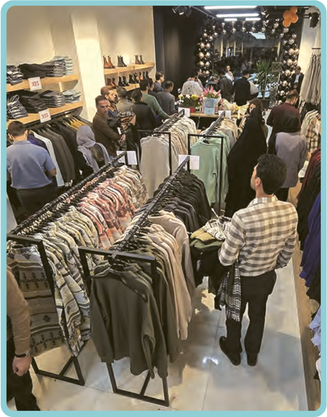

| الزّائِرَةُ | بائِعُ الْمَلابِسِ |
|---|---|
| رَجاءً، أَعْطِنی قَمیصاً مِنْ هٰذَا النَّوْعِ وَ ... کَمْ أَدْفَعُ¹؟ | صارَ الْمَبْلَغُ مِئَتَیْنِ وَ ثَلاثینَ أَلْفَ دینارٍ. اِدْفَعی بَعْدَ التَّخْفیضِ² مِئَتَیْنِ وَ عِشْرینَ أَلْفاً. |

۱ـ دَفَعَ: پرداخت کرد (مضارع: یَدْفَعُ = پرداخت می‌کند)  ۲ـ تَخْفیض: تخفیف
