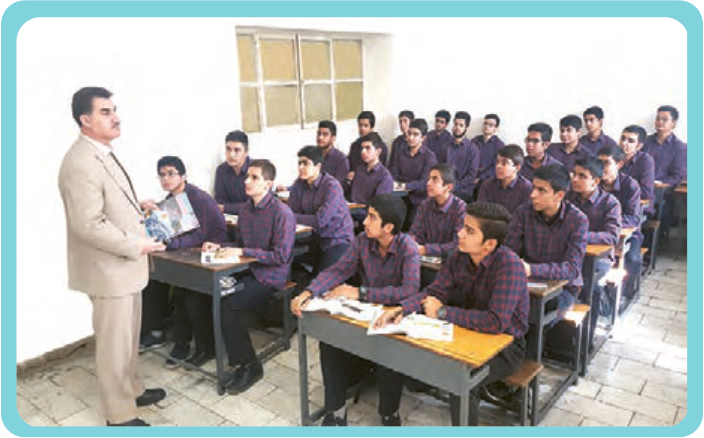

# الدَّرْسُ الثّانی
## فی آدابِ الصَّفِّ

کانَ الطُّلّابُ یَسْتَمِعُونَ إِلیٰ کَلامِ مُدَرِّسِ الْکیمیاءِ، وَ کانَ بَیْنَهُمْ طالِبٌ مُشاغِبٌ قَلیلُ الْأَدَبِ، یُؤْذِی الطُّلّابَ بِسُلُوکِهِ، یَلْتَفِتُ تارَةً إِلَی الْوَراءِ وَ یَمْزَحُ مَعَ الْآخَرینَ؛ فَنَصَحَهُ الْمُعَلِّمُ وَ قالَ: مَنْ لا یَسْتَمِعْ إِلَی الدَّرْسِ جَیِّداً یَرْسُبْ فِی الْإِمْتِحانِ. وَ لٰکِنَّ الطّالِبَ اسْتَمَرَّ فی سُلُوکِهِ.

فَکَّرَ مِهْرانُ حَوْلَ هٰذِهِ الْمُشْکِلَةِ، فَذَهَبَ إِلیٰ مُعَلِّمِ الْأَدَبِ الْفارِسِیِّ وَ شَرَحَ لَهُ الْقَضِیَّةَ وَ قالَ: أُحِبُّ أَنْ أَکْتُبَ إِنْشاءً تَحْتَ عُنْوانِ «فی آدابِ الصَّفِّ»؛ قالَ لَهُ الْمُعَلِّمُ: عَلَیْکَ أَنْ تُطالِعَ الْکُتُبَ التَّرْبَوِیَّةَ وَ آدابَ التَّعْلیمِ وَ التَّعَلُّمِ. وَ هٰذا ما کَتَبَهُ مِهْرانُ حَوْلَ «آدابِ الصَّفِّ».

