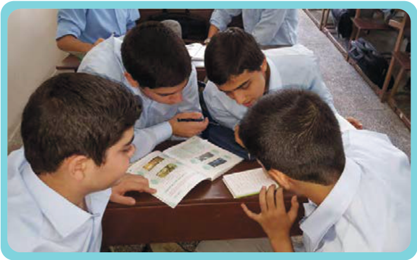

# اُکْتُبْ جَواباً قَصیراً، حَسَبَ نَصِّ الدَّرْسِ.

۱ـ إِلیٰ مَنْ ذَهَبَ مِهْرانُ؟

۲ـ مَتیٰ خَجِلَ الطّالِبُ وَ نَدِمَ؟

۳ـ کَیْفَ یُؤْذِی الطّالِبُ الْآخَرینَ؟

۴ـ ما هُوَ مَوْضُوعُ الْکُتُبِ الَّتی قَرَأَها مِهْرانُ؟

۵ـ فی أَیِّ صَفٍّ حَدَثَتْ هٰذِهِ الْقِصَّةُ؟

