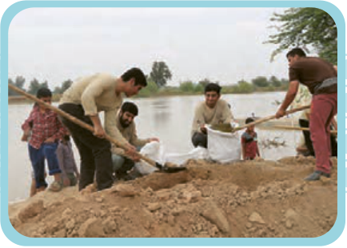

# اِخْتَبِرْ نَفْسَکَ: تَرْجِمْ ما یَلی¹، ثُمَّ عَیِّنْ أَداةَ الشَّرْطِ وَ فِعْلَ الشَّرْطِ، وَ جَوابَهُ.

۱. ﴿وَ ما تُقَدِّمُوا² لِأَنْفُسِکُمْ مِنْ خَیْرٍ تَجِدُوهُ عِنْدَ اللّٰهِ﴾ الْبَقَرَة: ۱۱۰

۲. ﴿إِنْ تَنْصُرُوا اللّٰهَ یَنْصُرْکُمْ وَ یُثَبِّتْ³ أَقْدامَکُمْ﴾ مُحَمَّد: ۷

۳. ﴿وَ إِذا خاطَبَهُمُ⁴ الْجاهِلُونَ قالُوا سَلاماً⁵﴾ الْفُرْقان: ۶۳

۴. إِنْ تَزْرَعُوا الْعُدْوانَ، تَحْصُدُوا الْخُسْرانَ.

۱ـ ما یَلی: آنچه می‌آید  ۲ـ ما تُقَدِّمُوا: هرچه را از پیش بفرستید  ۳ـ یُثَبِّتْ: استوار می‌سازد  ۴ـ خاطَبَ: خطاب کرد  ۵ـ سَلام: سخن آرام
