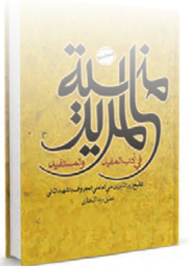

# الْبَحْثُ الْعِلْمِیُّ

■ اِبْحَثْ فی کِتابِ «مُنْیَةِ الْمُریدِ» لِزَیْنِ الدّینِ الْعامِلِیِّ «الشَّهیدِ الثّانی» عَنْ نَصٍّ قَصیرٍ حَوْلَ آدابِ التَّعْلیمِ وَ التَّعَلُّمِ ثُمَّ اُکْتُبْهُ.

الْعالِمُ کَمَنْ مَعَهُ شَمْعَةٌ تُضیءُ لِلنّاسِ. الْإِمامُ مُحَمَّدٌ الْباقِرُ عَلَیْهِ السَّلامُ

