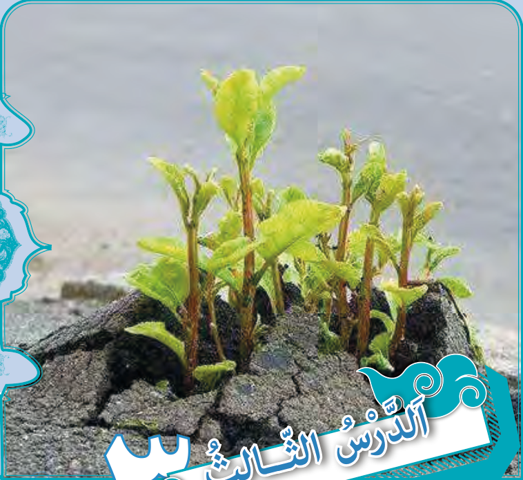

# الدَّرْسُ الثّالِثُ

﴿إِنَّ اللّٰهَ فالِقُ الْحَبِّ وَ النَّویٰ یُخْرِجُ الْحَیَّ مِنَ الْمَیِّتِ وَ مُخْرِجُ الْمَیِّتِ مِنَ الْحَیِّ ...﴾ الْأَنْعام: ۹۵

بی‌گمان خدا شکافندهٔ دانه و هسته است.

زنده را از مُرده بیرون می‌آورد و بیرون آورندهٔ مُرده از زنده است.
