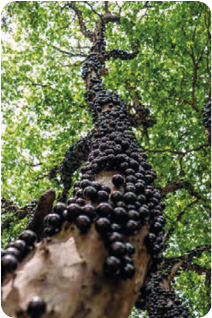
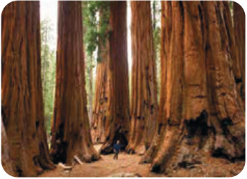

# الدَّرْسُ الثّالِثُ
## عَجائِبُ الْأَشْجارِ

ظَواهِرُ الطَّبیعَةِ تُثْبِتُ حَقیقَةً واحِدَةً وَ هِیَ قُدْرَةُ اللّٰهِ، وَ الْآنَ نَصِفُ بَعْضَ هٰذِهِ الظَّواهِرِ:

**الْعِنَبُ الْبُرازیلِیُّ** شَجَرَةٌ تَخْتَلِفُ عَنْ باقِی أَشْجارِ الْعالَمِ، تَنْبُتُ فِی الْبُرازیلِ، وَ تَنْمُو أَثْمارُها عَلیٰ جِذْعِها، وَ مِنْ أَهَمِّ مُواصَفاتِ هٰذِهِ الشَّجَرَةِ أَنَّها تُعْطی أَثْماراً طُولَ السَّنَةِ.

**شَجَرَةُ السَّکُویا** شَجَرَةٌ مِنْ أَطْوَلِ أَشْجارِ الْعالَمِ فی کالیفورنیا، قَدْ یَبْلُغُ اِرْتِفاعُ بَعْضِها أَکْثَرَ مِنْ مِئَةِ مِتْرٍ وَ قَدْ یَبْلُغُ قُطْرُها تِسْعَةَ أَمْتارٍ، وَ یَزیدُ عُمْرُها عَلیٰ ثَلاثَةِ آلافٍ وَ خَمْسِمِئَةِ سَنَةٍ تَقْریباً.

