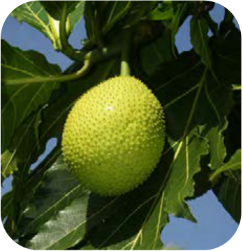
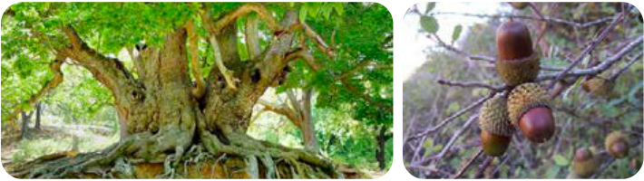

**شَجَرَةُ الْخُبْزِ** شَجَرَةٌ اِسْتِوائِیَّةٌ تَنْمُو فی جُزُرِ الْمُحیطِ الْهادِئِ، تَحْمِلُ أَثْماراً فی نِهایَةِ أَغْصانِها کَالْخُبْزِ. یَأْکُلُ النّاسُ لُبَّ هٰذِهِ الْأَثْمارِ.

**شَجَرَةُ الْبَلُّوطِ** هِیَ مِنَ الْأَشْجارِ الْمُعَمَّرَةِ وَ قَدْ تَبْلُغُ مِنَ الْعُمْرِ أَلْفَیْ سَنَةٍ. تُوجَدُ غاباتٌ جَمیلَةٌ مِنْها فی مُحافَظَتَیْ إیلام وَ لُرِستان. یَدْفِنُ السِّنْجابُ بَعْضَ جَوْزاتِ الْبَلُّوطِ السَّلیمَةِ تَحْتَ التُّرابِ، وَ قَدْ یَنْسیٰ مَکانَها. وَ فِی السَّنَةِ الْقادِمَةِ تَنْمُو تِلْکَ الْجَوْزَةُ وَ تَصیرُ شَجَرَةً.

قالَ الْإِمامُ الصّادِقُ عَلَیْهِ السَّلامُ:

اِزْرَعُوا وَ اغْرِسُوا، ... وَ اللّٰهِ ما عَمِلَ النّاسُ عَمَلاً أَحَلَّ وَ لا أَطْیَبَ مِنْهُ.

کشاورزی کنید و نهال بکارید، ... به خدا سوگند مردم کاری را حلال‌تر و خوب‌تر از آن انجام نداده‌اند.
