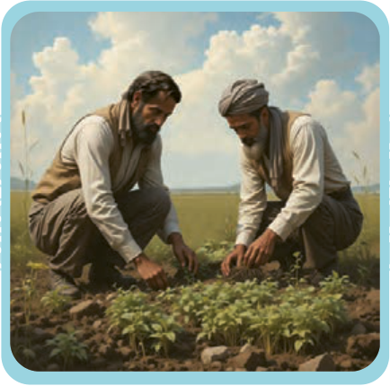

# الْمُعْجَم

| واژه | معنی |
|---|---|
| أَحَلّ | حلال‌تر، حلال‌ترین |
| أَطْیَب | خوب‌تر، خوب‌ترین = أَحْسَن، أَفْضَل |
| أَغْصان، غُصُون | شاخه‌ها «مفرد: غُصْن» |
| جِذْع | تنه «جمع: جُذُوع» |
| جُزُر | جزیره‌ها «مفرد: جَزیرَة» |
| جَوْزَة | دانهٔ گردو، بلوط و مانند آن |
| فالِق | شکافنده |
| لُبّ | مغز میوه |
| الْمُحیطُ الْهادِئ | اقیانوس آرام |
| مُعَمَّر | کهن‌سال |
| مُواصَفات | ویژگی‌ها |
| نَبَتَ | رویید (مضارع: یَنْبُتُ) |
| نَصِفُ | توصیف می‌کنیم |
| نَویٰ | هسته |

