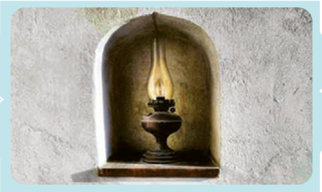

# اِخْتَبِرْ نَفْسَکَ: تَرْجِمْ ما یَلی¹ حَسَبَ قَواعِدِ الْمَعْرِفَةِ وَ النَّکِرَةِ.

۱. ﴿اللّٰهُ نُورُ السَّماواتِ وَ الْأَرْضِ مَثَلُ نُورِهِ کَمِشْکاةٍ² فیها مِصْباحٌ الْمِصْباحُ فی زُجاجَةٍ الزُّجاجَةُ کَأَنَّها کَوْکَبٌ دُرِّیٌّ³﴾ النُّور: ۳۵

۲. ﴿... أَرْسَلْنا إِلیٰ فِرْعَوْنَ رَسُولاً فَعَصیٰ فِرْعَوْنُ الرَّسُولَ ...﴾ الْمُزَّمِّل: ۱۵ و ۱۶

۳. عالِمٌ یُنْتَفَعُ بِعِلْمِهِ، خَیْرٌ مِنْ أَلْفِ عابِدٍ. رَسُولُ اللّٰهِ صَلَّی اللّٰهُ عَلَیْهِ وَ آلِهِ

۱ـ ما یَلی: آنچه می‌آید  ۲ـ الْمِشْکاة: چراغدان  ۳ـ الدُّرِّیّ: درخشان
