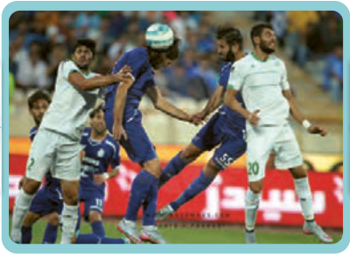

■ در گروه‌های دو نفره شبیه گفت‌وگوی زیر را اجرا کنید.

# حِوارٌ (فِی الْمَلْعَبِ)

| الْمُراسِلُ¹ | اللّاعِبُ² |
|---|---|
| أُهَنِّئُکَ³ بِفَوْزِ الْفَریقِ الْوَطَنِیِّ⁴. | شُکْراً جَزیلاً. |
| ما شُعُورُ اللّاعِبینَ بِهٰذَا الْفَوْزِ؟ | نَحْنُ نَشْعُرُ بِالسُّرُورِ وَ نَتَمَنّیٰ عَلَی کَأْسِ الْمُبارَیاتِ⁵. |
| وَ ما سِرُّ فَوْزِ الْفَریقِ فی هٰذِهِ الْمُباراةِ⁶؟ | نَحْنُ نَلْعَبُ بِکُلِّ حَماسٍ⁷ وَ نَتَعاوَنُ خِلالَ الْمُباراةِ. |
| وَ هَلْ عِنْدَکَ حَدیثٌ آخَرُ؟ | نَشْکُرُ الْمُدَرِّبَ⁸ وَ الْحَکَمَ⁹ وَ نُهَنِّئُ الشَّعْبَ وَ نَطْلُبُ مِنْهُمُ الدُّعاءَ لِلْفَوْزِ فِی الْمُباراةِ الْقادِمَةِ. |

۱ـ مُراسِل: خبرنگار  ۲ـ اللّاعِب: بازیکن  ۳ـ أُهَنِّئُ: تبریک می‌گویم  ۴ـ الْفَریقُ الْوَطَنِیّ: تیم ملّی  ۵ـ الْمُبارَیات: مسابقات  ۶ـ مُباراة: مسابقه  ۷ـ حَماس: شور و شوق، غیرت، هیجان  ۸ـ مُدَرِّب: مربّی  ۹ـ الْحَکَم: داور
